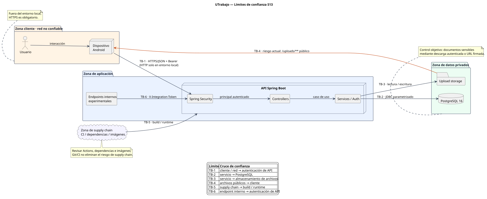
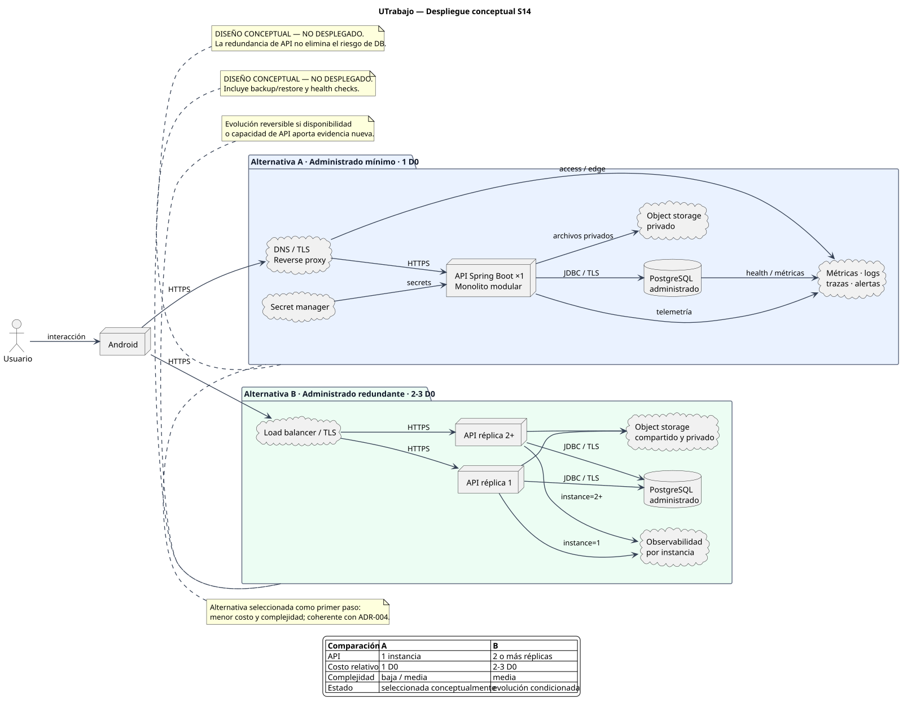

# Resumen ejecutivo — Semanas 13 y 14

> **Documento principal de navegación para exposición y revisión.** Todos los artefactos clave están enlazados para que el profesor pueda abrir la evidencia directamente desde este resumen.
>
> **Alcance:** el despliegue y la observabilidad de S14 son diseños conceptuales evaluados, no infraestructura productiva ya desplegada. Las imágenes renderizadas muestran la propuesta y no prueban aprovisionamiento real.

## Índice rápido de evidencias

| Evidencia | Enlace directo |
| --- | --- |
| Seguridad S13 — matriz de amenazas, controles y OWASP | [`dossier/10-seguridad.md`](10-seguridad.md) |
| Límites de confianza S13 | [SVG renderizado](../docs/security/trust-boundaries-s13.svg) · [PNG](../docs/security/trust-boundaries-s13.png) · [fuente PlantUML](../docs/security/trust-boundaries-s13.puml) |
| Auditoría de amenazas propuestas por IA | [`docs/security/auditoria-amenazas-ia-s13.md`](../docs/security/auditoria-amenazas-ia-s13.md) |
| Despliegue y observabilidad S14 | [`dossier/12-despliegue-observabilidad.md`](12-despliegue-observabilidad.md) |
| Diagrama conceptual de despliegue — no desplegado | [SVG renderizado](../docs/architecture/deployment-s14.svg) · [PNG](../docs/architecture/deployment-s14.png) · [fuente PlantUML](../docs/architecture/deployment-s14.puml) |
| Matriz de riesgos operativos S14 | [`docs/architecture/matriz-riesgos-operativos-s14.md`](../docs/architecture/matriz-riesgos-operativos-s14.md) |
| ADR-004 — distribución de Mensajería | [`docs/adr/ADR-004-distribucion-mensajeria.md`](../docs/adr/ADR-004-distribucion-mensajeria.md) |
| ADR-005 — despliegue y observabilidad | [`docs/adr/ADR-005-despliegue-observabilidad.md`](../docs/adr/ADR-005-despliegue-observabilidad.md) |
| ADR-006 — paginación del historial | [`docs/adr/ADR-006-paginacion-historial-mensajes.md`](../docs/adr/ADR-006-paginacion-historial-mensajes.md) |
| Fitness function de distribución | [`scripts/check_distribution_decision.py`](../scripts/check_distribution_decision.py) |
| Workflow que ejecuta la fitness function | [`.github/workflows/ci.yml`](../.github/workflows/ci.yml) |
| Evidencia CI rojo → verde S14 | [`docs/architecture/evidencia-fitness-ci-s14.md`](../docs/architecture/evidencia-fitness-ci-s14.md) |
| Matriz de fallos previa | [`docs/architecture/failure-modes-walking-skeleton.md`](../docs/architecture/failure-modes-walking-skeleton.md) |
| Evidencia de crecimiento S11 | [`experimentos/crecimiento-mensajeria/`](../experimentos/crecimiento-mensajeria/) |
| Checklist verificable S13–S14 | [`dossier/21-checklist-semanas-13-14.md`](21-checklist-semanas-13-14.md) |
| PR Semana 13 | [PR #26 — Seguridad S13](https://github.com/plantedseeker/Proyectlo_Arquitectura_software/pull/26) |
| PR Semana 14 | [PR #27 — Despliegue, observabilidad y fitness CI](https://github.com/plantedseeker/Proyectlo_Arquitectura_software/pull/27) |
| CI rojo deliberado | [GitHub Actions run #60](https://github.com/plantedseeker/Proyectlo_Arquitectura_software/actions/runs/40039705894) |
| CI verde final | [GitHub Actions run #64](https://github.com/plantedseeker/Proyectlo_Arquitectura_software/actions/runs/40040820129) |
| OWASP Top 10:2025 | [Sitio oficial de OWASP](https://top10.owasp.org/2025/) |

## Tesis ejecutiva

UTrabajo ya tenía controles reales de autenticación, autorización, persistencia y CI, pero eso no equivalía a un modelo de seguridad ni a un plan operativo. S13 convierte esos controles en un **threat model priorizado** usando [OWASP Top 10:2025](https://top10.owasp.org/2025/) y distingue riesgos reales de amenazas genéricas. La evidencia principal está en [`dossier/10-seguridad.md`](10-seguridad.md).

S14 toma esos riesgos, los [fallos ya documentados](../docs/architecture/failure-modes-walking-skeleton.md) y la evidencia previa de rendimiento para diseñar un **despliegue conceptual observable**, con dos alternativas de costo, métricas/logs/trazas/alertas, una [matriz de riesgos operativos](../docs/architecture/matriz-riesgos-operativos-s14.md) y una decisión formal en [ADR-005](../docs/adr/ADR-005-despliegue-observabilidad.md).

La decisión evita dos errores:

1. declarar “seguro” un laboratorio local;
2. introducir Kubernetes/microservicios antes de tener una necesidad medida.

## Resultado en una página

| Pregunta | Respuesta respaldada | Evidencia |
| --- | --- | --- |
| ¿Qué amenaza domina? | acceso indebido a datos privados/configuración local expuesta; además falta detección operativa | [S13 — matriz T01–T12](10-seguridad.md) |
| ¿El sistema ya tiene controles? | sí: BCrypt, tokens aleatorios+hash, expiración, roles, participante de chat, SQL parametrizado, límites de archivo y CI | [SecurityConfig](../backend/src/main/kotlin/com/tab/utrabajo/api/config/SecurityConfig.kt), [AuthService](../backend/src/main/kotlin/com/tab/utrabajo/api/auth/AuthService.kt), [UTrabajoService](../backend/src/main/kotlin/com/tab/utrabajo/api/service/UTrabajoService.kt), [FileStorageService](../backend/src/main/kotlin/com/tab/utrabajo/api/service/FileStorageService.kt) |
| ¿Qué riesgo nuevo se detectó? | documentos sensibles bajo `/uploads/**` anónimo y ausencia de logging/alerting de seguridad | [S13](10-seguridad.md), [SecurityConfig](../backend/src/main/kotlin/com/tab/utrabajo/api/config/SecurityConfig.kt), [WebConfig](../backend/src/main/kotlin/com/tab/utrabajo/api/config/WebConfig.kt) |
| ¿Qué propone S13? | priorizar T01–T12 y cerrar P0 antes de Internet | [S13](10-seguridad.md) |
| ¿Qué despliegue propone S14? | diseño conceptual de monolito modular administrado: TLS + API + PostgreSQL administrado + object storage privado + observabilidad; no está desplegado | [S14](12-despliegue-observabilidad.md), [diagrama renderizado](../docs/architecture/deployment-s14.svg) |
| ¿Alternativa? | monolito redundante detrás de load balancer | [S14](12-despliegue-observabilidad.md) |
| ¿Costo? | A=1 D0; B=2–3 D0, estimación relativa, no precio | [S14 — comparación](12-despliegue-observabilidad.md) |
| ¿SLO de latencia reutilizado? | p95 ≤500 ms | [S14](12-despliegue-observabilidad.md), [experimento de crecimiento S11](../experimentos/crecimiento-mensajeria/) |
| ¿Cómo sabremos que falla? | health, 5xx, p95, pool DB, storage, auth/403, backups | [plan de observabilidad](12-despliegue-observabilidad.md) |
| ¿Qué decisión formal? | ADR-005 adopta A conceptualmente y conserva B como evolución reversible | [ADR-005](../docs/adr/ADR-005-despliegue-observabilidad.md) |
| ¿La fitness function funciona? | sí; CI la ejecuta y S14 conserva una violación deliberada roja seguida de corrección verde | [evidencia CI](../docs/architecture/evidencia-fitness-ci-s14.md), [run rojo #60](https://github.com/plantedseeker/Proyectlo_Arquitectura_software/actions/runs/40039705894), [run verde #64](https://github.com/plantedseeker/Proyectlo_Arquitectura_software/actions/runs/40040820129) |

# Semana 13 — Seguridad

## Método

1. inventariar activos;
2. dibujar [límites de confianza](../docs/security/trust-boundaries-s13.svg) y conservar su [fuente PlantUML](../docs/security/trust-boundaries-s13.puml);
3. mapear [OWASP Top 10:2025](https://top10.owasp.org/2025/);
4. contrastar cada amenaza con código/configuración;
5. puntuar probabilidad e impacto;
6. separar control existente, riesgo residual y control propuesto;
7. rechazar amenazas genéricas sin superficie real mediante la [auditoría crítica de IA](../docs/security/auditoria-amenazas-ia-s13.md).

La matriz completa está en [`dossier/10-seguridad.md`](10-seguridad.md).

## Activos críticos

- credenciales/sesiones;
- chats;
- CV y documentos empresariales;
- ofertas/postulaciones;
- PostgreSQL;
- secrets/configuración;
- CI/dependencias.

[Ver inventario y clasificación en la evidencia S13.](10-seguridad.md)

## Límites de confianza

~~~text
Android
   │
=== TB1 ===
   ▼
Spring Security → Controllers → Services
   │                         │
=== TB2 ===                === TB3 ===
   ▼                         ▼
PostgreSQL               File storage
                             │
                         === TB4 ===
                             ▼
                          /uploads

CI/dependencias === TB5
Endpoints internos === TB6
~~~

**Evidencia:** [SVG renderizado](../docs/security/trust-boundaries-s13.svg), [PNG](../docs/security/trust-boundaries-s13.png) y [fuente PlantUML](../docs/security/trust-boundaries-s13.puml).

## Amenazas que debes saber defender

### T01 — acceso a chat ajeno

OWASP A01. Es de impacto crítico, pero existe control real: [`requireChatParticipant` dentro de `UTrabajoService`](../backend/src/main/kotlin/com/tab/utrabajo/api/service/UTrabajoService.kt) y pruebas negativas en [`UTrabajoApiApplicationTests.kt`](../backend/src/test/kotlin/com/tab/utrabajo/api/UTrabajoApiApplicationTests.kt).

**Mensaje:** “No asumimos que conocer el UUID autoriza; el servidor resuelve el principal y verifica participación.”

[Ver T01 y su priorización en la matriz S13.](10-seguridad.md)

### T02 — documentos sensibles públicos

[`SecurityConfig`](../backend/src/main/kotlin/com/tab/utrabajo/api/config/SecurityConfig.kt) permite `/uploads/**` de forma anónima y [`WebConfig`](../backend/src/main/kotlin/com/tab/utrabajo/api/config/WebConfig.kt) publica esa ruta como recurso. Los UUID reducen descubrimiento, pero **no sustituyen autorización**.

**Decisión:** antes de Internet, documentos sensibles deben descargarse autenticadamente o mediante URL firmada; avatar puede tener política distinta.

[Ver T02 en la evidencia S13.](10-seguridad.md)

### T03 — configuración local publicada

El [`docker-compose.yml`](../docker-compose.yml) y la configuración actual contienen HTTP, `SEED_DEMO=true`, credenciales locales e integration token demo. Son válidos en laboratorio, no en producción.

**Decisión:** perfil de producción con HTTPS, secrets externos y seed deshabilitado.

[Ver T03 y el control C-S13-03.](10-seguridad.md)

### T04 — ceguera de seguridad

La configuración actual de [`application.yml`](../backend/src/main/resources/application.yml) expone health/info, pero eso no permite por sí solo saber quién está fallando autenticación, qué endpoint produce 5xx o si crecen los 403.

**Decisión:** [S14 crea el plan de observabilidad de seguridad.](12-despliegue-observabilidad.md)

### T05/T06 — autenticación y token

Hay BCrypt, token aleatorio, hash y expiración en [`SecurityConfig`](../backend/src/main/kotlin/com/tab/utrabajo/api/config/SecurityConfig.kt) y [`AuthService`](../backend/src/main/kotlin/com/tab/utrabajo/api/auth/AuthService.kt). Falta rate limiting de login y fuera de local TLS es obligatorio.

[Ver riesgos T05/T06.](10-seguridad.md)

## Amenazas genéricas rechazadas

- XXE: no se procesa XML.
- SSRF crítico: el backend no hace fetch de URLs arbitrarias del usuario.
- XSS server-side como principal: API JSON + Android Compose, no templates HTML.
- CSRF crítico solo por estar deshabilitado: API stateless con Bearer header; reabrir si se usan cookies.
- microservicios “por seguridad”: agregan secretos/red y no corrigen automáticamente las amenazas P0.

**Evidencia completa:** [`docs/security/auditoria-amenazas-ia-s13.md`](../docs/security/auditoria-amenazas-ia-s13.md).

## Conclusión S13

El sistema tiene una base razonable para laboratorio, pero no está autorizado a declararse “production secure”. Las prioridades P0 son **control de acceso/documentos, configuración segura y capacidad de detectar incidentes**.

La decisión completa y el riesgo residual se encuentran en [`dossier/10-seguridad.md`](10-seguridad.md). El trabajo de S13 fue entregado mediante [PR #26](https://github.com/plantedseeker/Proyectlo_Arquitectura_software/pull/26).

# Semana 14 — Despliegue y observabilidad

## Dos alternativas

La comparación completa está en [`dossier/12-despliegue-observabilidad.md`](12-despliegue-observabilidad.md). El profesor puede abrir el [SVG renderizado](../docs/architecture/deployment-s14.svg), el [PNG](../docs/architecture/deployment-s14.png) o la [fuente PlantUML](../docs/architecture/deployment-s14.puml). El diagrama representa una propuesta conceptual, no infraestructura aprovisionada.

### A — administrado mínimo — seleccionada

~~~text
Android
   │ HTTPS
   ▼
TLS / Reverse proxy
   ▼
1 × Spring Boot API
   ├── PostgreSQL administrado
   ├── Object storage privado
   ├── Secret manager
   └── Metrics + Logs + Traces
~~~

Costo: **1 D0**.

### B — administrado redundante

~~~text
Android
   │ HTTPS
   ▼
Load balancer
 ┌───────┴───────┐
 ▼               ▼
API 1           API 2
 └───────┬───────┘
         ▼
 PostgreSQL administrado
 + object storage + observabilidad
~~~

Costo: **2–3 D0**.

B mejora disponibilidad de API y escalado horizontal, pero la evidencia previa no demuestra que hoy haga falta. La continuidad de la decisión de no distribuir prematuramente está respaldada por [ADR-004](../docs/adr/ADR-004-distribucion-mensajeria.md).

## Observabilidad

El plan completo está en [`dossier/12-despliegue-observabilidad.md`](12-despliegue-observabilidad.md).

### Métricas esenciales

~~~text
Rate
Errors
Duration p95/p99
JVM
Hikari pool
DB health/latency
401/403/login failures
Storage usage/errors
~~~

### Logs

Estructurados con:

~~~text
timestamp level service instance
requestId traceId spanId
route status duration error.type
~~~

Nunca tokens, contraseñas, chat bodies o documentos.

### Trazas

~~~text
HTTP
 ↓
Security
 ↓
Controller
 ↓
Service/Auth
 ↓
JDBC
 ↓
PostgreSQL
~~~

### Alertas que debes memorizar

~~~text
health DOWN >2 min        → crítica
5xx >5 % por 5 min       → crítica
p95 >500 ms por 5 min    → crítica
DB pool >90 % sostenido  → warning/crítica
storage >85 %            → warning
backup vencido           → crítica
login/403 anómalos       → seguridad
~~~

Solo p95=500 ms proviene del SLO previo. Los demás son umbrales operativos iniciales sujetos a calibración.

## Fallos previos convertidos en señales

La fuente de los fallos está en [`failure-modes-walking-skeleton.md`](../docs/architecture/failure-modes-walking-skeleton.md).

| Fallo | Señal S14 |
| --- | --- |
| PostgreSQL cae | health + JDBC + pool |
| API cae | health DOWN |
| storage lleno | % uso + errores IO |
| token inválido | 401 |
| chat ajeno | 403 |
| offset profundo | p95 + DB duration |
| polling crece | request rate + p95 |
| config local publicada | gate de despliegue, no esperar una alerta |

La relación completa fallo → métrica → log → traza → alerta está en [S14](12-despliegue-observabilidad.md).

## Riesgos operativos

La priorización O01–O14 está en [`docs/architecture/matriz-riesgos-operativos-s14.md`](../docs/architecture/matriz-riesgos-operativos-s14.md).

## ADR-005

**Decisión formal:** [`docs/adr/ADR-005-despliegue-observabilidad.md`](../docs/adr/ADR-005-despliegue-observabilidad.md).

> El primer despliegue público de UTrabajo debe conservar el monolito modular, pero ejecutarse detrás de TLS, con PostgreSQL administrado, almacenamiento privado, secrets externos y observabilidad centralizada. La redundancia de API se incorpora solo ante un SLO o límite medido que la justifique.

La decisión histórica de paginación queda preservada en [ADR-006](../docs/adr/ADR-006-paginacion-historial-mensajes.md).

# Fitness function — demostración S14

La regla ejecutable está en [`scripts/check_distribution_decision.py`](../scripts/check_distribution_decision.py) y GitHub Actions la ejecuta desde [`.github/workflows/ci.yml`](../.github/workflows/ci.yml).

~~~text
scripts/check_distribution_decision.py
threshold = 0 violations
~~~

Detecta, entre otros:

- nuevo servicio Compose no aprobado;
- Kafka/RabbitMQ/Redis/Pulsar/NATS;
- caché experimental habilitada por default.

La evidencia narrativa completa está en [`docs/architecture/evidencia-fitness-ci-s14.md`](../docs/architecture/evidencia-fitness-ci-s14.md).

## Evidencia real de CI rojo

Se introdujo deliberadamente una violación solo en la rama del PR #27:

~~~text
MESSAGE_CACHE_ENABLED=true por defecto
~~~

GitHub Actions falló exactamente en:

~~~text
Enforce ADR-004 distribution decision
~~~

**Abrir evidencia:** [run #60 — CI rojo](https://github.com/plantedseeker/Proyectlo_Arquitectura_software/actions/runs/40039705894).

## Corrección y CI verde

La configuración fue restaurada a:

~~~text
MESSAGE_CACHE_ENABLED=false por defecto
~~~

El head final pasó backend, Android y la fitness function.

**Abrir evidencia:** [run #64 — CI verde final](https://github.com/plantedseeker/Proyectlo_Arquitectura_software/actions/runs/40040820129).

El trabajo completo de S14 puede revisarse en [PR #27](https://github.com/plantedseeker/Proyectlo_Arquitectura_software/pull/27).

Esto demuestra:

~~~text
regla escrita
    ↓
regla ejecutada
    ↓
violación
    ↓
CI ROJO
    ↓
corrección
    ↓
CI VERDE
~~~

La violación nunca fue fusionada a `main`.

# Recorrido recomendado para el profesor

1. Abrir [`dossier/10-seguridad.md`](10-seguridad.md).
2. Abrir el [mapa renderizado de trust boundaries](../docs/security/trust-boundaries-s13.svg).
3. Revisar T01–T04 y los controles en [la matriz S13](10-seguridad.md).
4. Revisar [amenazas de IA aceptadas/rechazadas](../docs/security/auditoria-amenazas-ia-s13.md).
5. Abrir [`dossier/12-despliegue-observabilidad.md`](12-despliegue-observabilidad.md).
6. Abrir el [diagrama renderizado de despliegue](../docs/architecture/deployment-s14.svg) y comparar 1 D0 vs 2–3 D0, aclarando que ambas topologías son conceptuales.
7. Revisar métricas/logs/trazas/alertas en [S14](12-despliegue-observabilidad.md).
8. Abrir la [matriz de riesgos operativos](../docs/architecture/matriz-riesgos-operativos-s14.md).
9. Abrir [ADR-005](../docs/adr/ADR-005-despliegue-observabilidad.md).
10. Abrir [run #60 rojo](https://github.com/plantedseeker/Proyectlo_Arquitectura_software/actions/runs/40039705894) y luego [run #64 verde](https://github.com/plantedseeker/Proyectlo_Arquitectura_software/actions/runs/40040820129).
11. Si desea revisar el cumplimiento requisito por requisito, abrir [`dossier/21-checklist-semanas-13-14.md`](21-checklist-semanas-13-14.md).

# Guion de defensa — 8 a 10 minutos

| Tiempo | Contenido | Evidencia clicable |
| ---: | --- | --- |
| 0:00–0:45 | tesis S13–S14 | [este resumen](22-resumen-ejecutivo-s13-s14.md) |
| 0:45–2:00 | activos y límites de confianza | [S13](10-seguridad.md), [trust boundaries renderizado](../docs/security/trust-boundaries-s13.svg) |
| 2:00–3:30 | amenazas prioritarias y controles | [matriz S13](10-seguridad.md) |
| 3:30–4:15 | amenazas IA rechazadas | [auditoría IA](../docs/security/auditoria-amenazas-ia-s13.md) |
| 4:15–5:30 | despliegue conceptual A vs B y costo | [S14](12-despliegue-observabilidad.md), [diagrama renderizado](../docs/architecture/deployment-s14.svg) |
| 5:30–7:00 | métricas, logs, trazas y alertas | [plan S14](12-despliegue-observabilidad.md) |
| 7:00–8:00 | riesgos operativos | [matriz O01–O14](../docs/architecture/matriz-riesgos-operativos-s14.md) |
| 8:00–9:00 | ADR-005 | [decisión formal](../docs/adr/ADR-005-despliegue-observabilidad.md) |
| 9:00–10:00 | CI rojo→verde y conclusión | [evidencia](../docs/architecture/evidencia-fitness-ci-s14.md), [rojo](https://github.com/plantedseeker/Proyectlo_Arquitectura_software/actions/runs/40039705894), [verde](https://github.com/plantedseeker/Proyectlo_Arquitectura_software/actions/runs/40040820129) |

## Explicación compacta

> En S13 dejamos de tratar seguridad como una lista genérica: modelamos activos y límites de confianza, contrastamos OWASP contra el código y priorizamos amenazas reales. Encontramos controles existentes fuertes en autenticación, autorización y SQL parametrizado, pero también riesgos que impiden publicar la configuración local tal cual, especialmente documentos sensibles públicos y falta de logging/alerting. En S14 convertimos esos riesgos y los fallos anteriores en un plan operativo: comparamos dos despliegues, elegimos como primer paso un monolito administrado observable, definimos señales y alertas y lo formalizamos en ADR-005. Finalmente demostramos que la fitness function realmente protege una decisión haciendo fallar CI con una violación deliberada y corrigiéndola antes de fusionar.

# Qué NO afirmar

- “Cumplimos OWASP completo”.
- “La aplicación ya está segura para Internet”.
- “Tenemos alta disponibilidad desplegada”.
- “Grafana k6 ya es toda la observabilidad de producción”.
- “La alternativa B es necesaria”.
- “Los umbrales de seguridad fueron medidos”; varios son iniciales.
- “La violación roja llegó a main”.

# Estado honesto de cierre

La evidencia documental/técnica de S13–S14 está preparada. La infraestructura pública sigue siendo conceptual y cualquier ratificación humana debe registrarse solo cuando ocurra.

Para una revisión de cumplimiento pura, sin guion de exposición, usar [`dossier/21-checklist-semanas-13-14.md`](21-checklist-semanas-13-14.md).
