# Informe final — Corte 3 (Semanas 9 a 14)

> **Proyecto:** UTrabajo  
> **Categoría arquitectónica:** Mensajería y mesa de ayuda  
> **Propósito del documento:** reunir en un único recorrido navegable toda la evidencia técnica, experimental, documental y de CI del tercer corte para la presentación final.
>
> **Corte histórico de referencia para el cierre documentado:** `main` después de PR #33, commit `5489e21fdcd88c9d4639bfaf5fb9d66bdf72d7eb`, con UTrabajo CI #77 en `success`. Este valor identifica el estado que se resume; el propio informe puede recibir commits posteriores de documentación.
>
> **Regla de lectura:** este informe distingue claramente entre **evidencia medida**, **decisión propuesta**, **diseño conceptual** y **actividad humana pendiente**. No se presenta como hecho algo que el repositorio no demuestra.

---

# 0. Cómo usar este informe en la presentación final

Este archivo está pensado para funcionar como **portada de navegación** del Corte 3. El profesor puede empezar aquí y abrir cada evidencia sin buscar manualmente carpetas.

## Accesos directos principales

| Bloque | Evidencia principal |
| --- | --- |
| **Historia completa — desde el inicio hasta el cierre actual** | **[`24-evolucion-completa-utrabajo.md`](24-evolucion-completa-utrabajo.md)** |
| **Semana 9 — dominio e integración** | [`09-api-events-integration.md`](09-api-events-integration.md) |
| **Semanas 9–10 — resumen de Módulo 5** | [`18-resumen-ejecutivo-modulo-5.md`](18-resumen-ejecutivo-modulo-5.md) |
| **Semanas 9–10 — checklist verificable** | [`17-checklist-modulo-5.md`](17-checklist-modulo-5.md) |
| **Semana 10 — Spike 1** | [`experimentos/spike-01-integracion/`](../experimentos/spike-01-integracion/) |
| **ADR-003 — integración Mensajería → Ofertas** | [`ADR-003-integracion-contextos.md`](../docs/adr/ADR-003-integracion-contextos.md) |
| **Semanas 11–12 — resumen ejecutivo** | [`19-resumen-ejecutivo-s11-s12.md`](19-resumen-ejecutivo-s11-s12.md) |
| **Semanas 11–12 — checklist** | [`20-checklist-semanas-11-12.md`](20-checklist-semanas-11-12.md) |
| **Semana 11 — experimento de crecimiento** | [`experimentos/crecimiento-mensajeria/`](../experimentos/crecimiento-mensajeria/) |
| **ADR-004 — distribución de Mensajería** | [`ADR-004-distribucion-mensajeria.md`](../docs/adr/ADR-004-distribucion-mensajeria.md) |
| **Semana 12 — fitness function** | [`fitness-function-distribucion-s12.md`](../docs/architecture/fitness-function-distribucion-s12.md) |
| **Semana 13 — seguridad** | [`10-seguridad.md`](10-seguridad.md) |
| **Semana 13 — trust boundaries** | [SVG](../docs/security/trust-boundaries-s13.svg) · [PNG](../docs/security/trust-boundaries-s13.png) · [PlantUML](../docs/security/trust-boundaries-s13.puml) |
| **Semana 14 — despliegue y observabilidad** | [`12-despliegue-observabilidad.md`](12-despliegue-observabilidad.md) |
| **Semana 14 — diagrama de despliegue** | [SVG](../docs/architecture/deployment-s14.svg) · [PNG](../docs/architecture/deployment-s14.png) · [PlantUML](../docs/architecture/deployment-s14.puml) |
| **ADR-005 — despliegue y observabilidad** | [`ADR-005-despliegue-observabilidad.md`](../docs/adr/ADR-005-despliegue-observabilidad.md) |
| **ADR-006 — paginación histórica** | [`ADR-006-paginacion-historial-mensajes.md`](../docs/adr/ADR-006-paginacion-historial-mensajes.md) |
| **Semanas 13–14 — resumen navegable** | [`22-resumen-ejecutivo-s13-s14.md`](22-resumen-ejecutivo-s13-s14.md) |
| **Semanas 13–14 — checklist** | [`21-checklist-semanas-13-14.md`](21-checklist-semanas-13-14.md) |
| **Uso crítico del Tutor — A1–A6** | [`23-tarea-2-uso-critico-tutor-modulo-6.md`](23-tarea-2-uso-critico-tutor-modulo-6.md) |
| **CI rojo por fitness function** | [GitHub Actions run #60](https://github.com/plantedseeker/Proyectlo_Arquitectura_software/actions/runs/40039705894) |
| **CI verde posterior** | [GitHub Actions run #64](https://github.com/plantedseeker/Proyectlo_Arquitectura_software/actions/runs/40040820129) |

---

# 0.1 De dónde venimos y dónde estamos

Para explicar el proyecto completo —no solo S9–S14— existe un documento histórico dedicado:

**[24 — Evolución completa de UTrabajo: desde el sistema inicial hasta el estado actual](24-evolucion-completa-utrabajo.md)**

Ese recorrido parte de que UTrabajo ya existía como aplicación Android + API + PostgreSQL, documenta S1–S14, C4, walking skeleton, métricas, ADR, errores, recuperación, PR, CI, seguridad, despliegue, renovación visual y el cierre consolidado. También conserva los pendientes reales detectados por la auditoría extrema.

En una frase:

~~~text
AL INICIO
producto funcional + arquitectura mayormente implícita

        ↓ semestre

AL CIERRE
producto funcional + arquitectura explícita + mediciones + ADR + CI + seguridad + evidencia navegable
~~~

---

# Galería visual embebida — evidencia tal como fue conservada

> Esta sección muestra **la imagen directamente dentro del documento** y mantiene debajo el vínculo al archivo original versionado. La imagen sirve para exposición; el archivo original, los JSON, logs, código, PR y CI siguen siendo la evidencia auditable.

> **Uso recomendado:** durante la sustentación, mostrar primero la captura y, si el profesor pregunta “¿dónde está?”, abrir el enlace **Evidencia original** que aparece inmediatamente debajo.

## A. Semanas 5–8 — ejecución, walking skeleton, medición y primera restricción

### Checklist visual S5–S6

Estado visual del bloque C4/walking skeleton.

[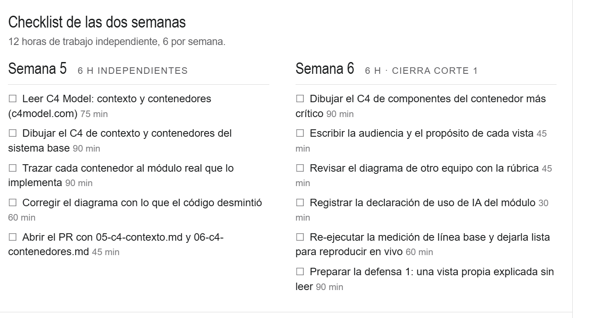](evidencias-exposicion/00-checklist-s5-s6.png)

**Evidencia original:** [`evidencias-exposicion/00-checklist-s5-s6.png`](evidencias-exposicion/00-checklist-s5-s6.png)

---

### Checklist visual S7–S8

Estado visual de localización, ADR y restricción.

[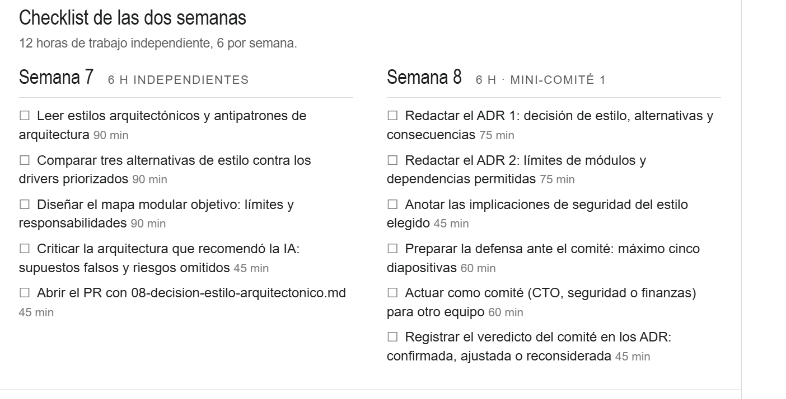](evidencias-exposicion/01-checklist-s7-s8.png)

**Evidencia original:** [`evidencias-exposicion/01-checklist-s7-s8.png`](evidencias-exposicion/01-checklist-s7-s8.png)

---

### Rama sincronizada

Preparación del entorno Git antes de la demostración.

[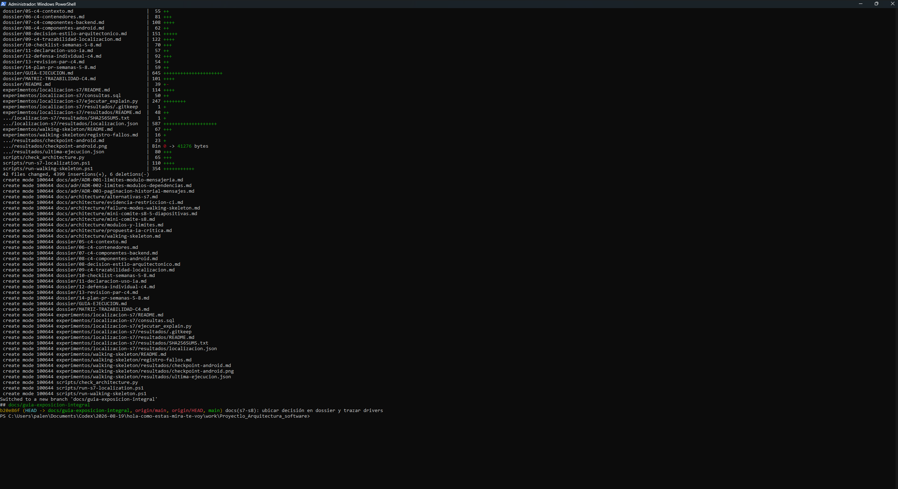](evidencias-exposicion/02-rama-sincronizada.png)

**Evidencia original:** [`evidencias-exposicion/02-rama-sincronizada.png`](evidencias-exposicion/02-rama-sincronizada.png)

---

### Preflight — puertos ocupados

Detección previa de conflicto de puertos.

[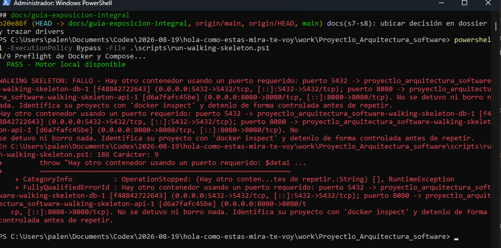](evidencias-exposicion/03-preflight-puertos-ocupados.png)

**Evidencia original:** [`evidencias-exposicion/03-preflight-puertos-ocupados.png`](evidencias-exposicion/03-preflight-puertos-ocupados.png)

---

### Walking skeleton inicial

Ejecución del recorrido vertical del sistema.

[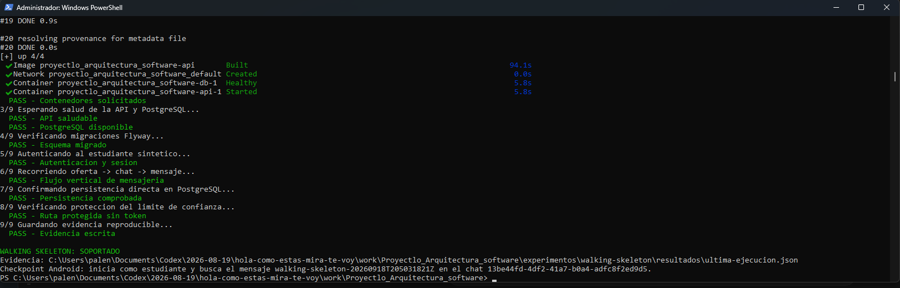](evidencias-exposicion/04-walking-skeleton-inicial.png)

**Evidencia original:** [`evidencias-exposicion/04-walking-skeleton-inicial.png`](evidencias-exposicion/04-walking-skeleton-inicial.png)

---

### Fallo controlado de API

Fallo intencional usado para observar la señal del sistema.

[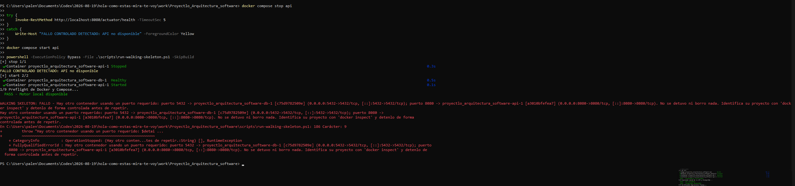](evidencias-exposicion/05-fallo-controlado-api.png)

**Evidencia original:** [`evidencias-exposicion/05-fallo-controlado-api.png`](evidencias-exposicion/05-fallo-controlado-api.png)

---

### Walking skeleton recuperado

Recuperación posterior al fallo sin borrar la evidencia.

[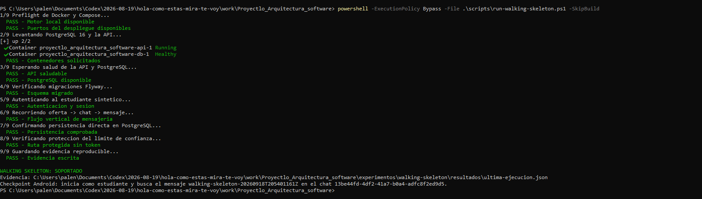](evidencias-exposicion/06-walking-skeleton-recuperado.png)

**Evidencia original:** [`evidencias-exposicion/06-walking-skeleton-recuperado.png`](evidencias-exposicion/06-walking-skeleton-recuperado.png)

---

### Artefactos del walking skeleton

Resultados/artefactos producidos por la ejecución.

[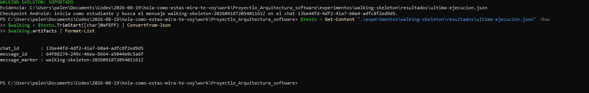](evidencias-exposicion/07-walking-skeleton-artefactos.png)

**Evidencia original:** [`evidencias-exposicion/07-walking-skeleton-artefactos.png`](evidencias-exposicion/07-walking-skeleton-artefactos.png)

---

### Marcador visible en Android

Checkpoint visual del mismo recorrido desde el cliente Android.

[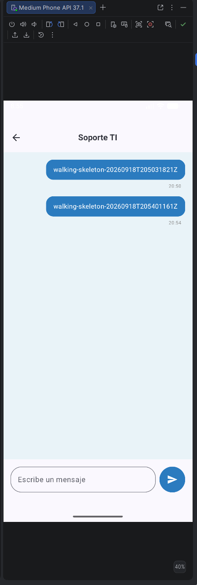](evidencias-exposicion/08-android-marcador.png)

**Evidencia original:** [`evidencias-exposicion/08-android-marcador.png`](evidencias-exposicion/08-android-marcador.png)

---

### Línea base — ejecución

Ejecución real del instrumento de línea base.

[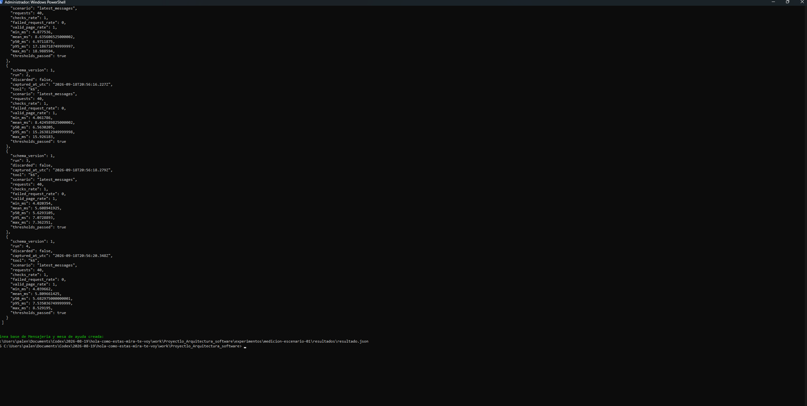](evidencias-exposicion/09-linea-base-ejecucion.png)

**Evidencia original:** [`evidencias-exposicion/09-linea-base-ejecucion.png`](evidencias-exposicion/09-linea-base-ejecucion.png)

---

### Línea base — resumen

Resumen visual de las corridas y resultado.

[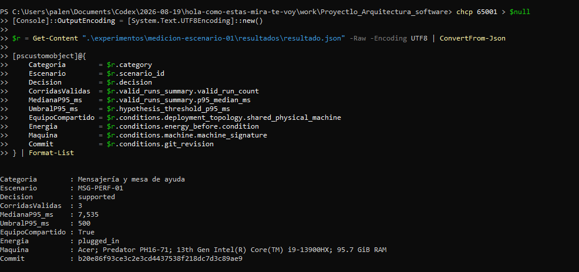](evidencias-exposicion/10-linea-base-resumen.png)

**Evidencia original:** [`evidencias-exposicion/10-linea-base-resumen.png`](evidencias-exposicion/10-linea-base-resumen.png)

---

### S7 — inicio de localización

Inicio del instrumento de localización SQL.

[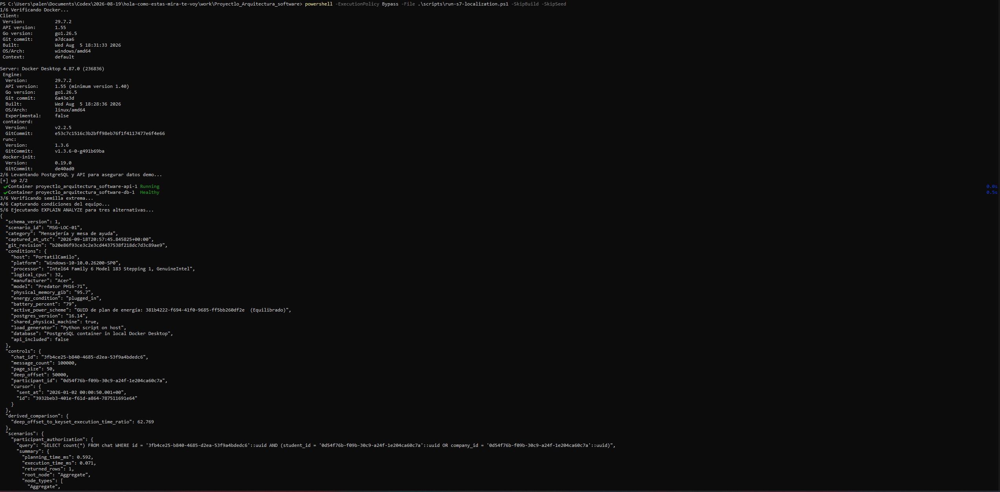](evidencias-exposicion/11-s7-ejecucion-inicio.png)

**Evidencia original:** [`evidencias-exposicion/11-s7-ejecucion-inicio.png`](evidencias-exposicion/11-s7-ejecucion-inicio.png)

---

### S7 — fin de localización

Finalización de la ejecución S7.

[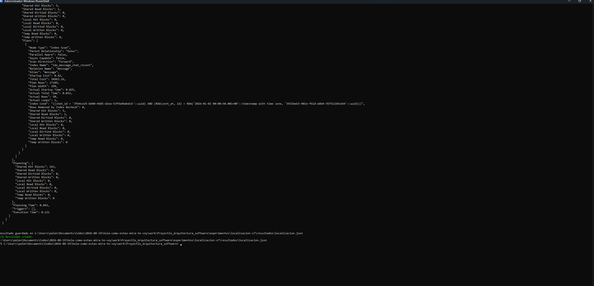](evidencias-exposicion/12-s7-ejecucion-fin.png)

**Evidencia original:** [`evidencias-exposicion/12-s7-ejecucion-fin.png`](evidencias-exposicion/12-s7-ejecucion-fin.png)

---

### S7 — resumen

Comparación visual de página reciente, offset profundo y cursor.

[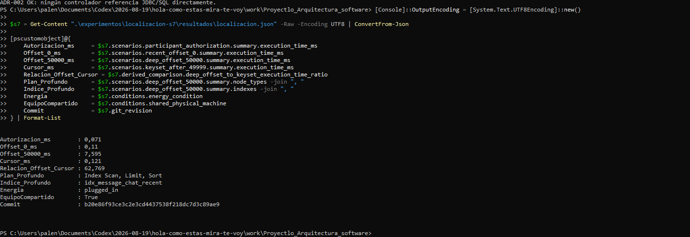](evidencias-exposicion/13-s7-resumen.png)

**Evidencia original:** [`evidencias-exposicion/13-s7-resumen.png`](evidencias-exposicion/13-s7-resumen.png)

---

### ADR-002 — restricción

Evidencia visual de la regla que protege la frontera controller → service/auth → persistencia.

[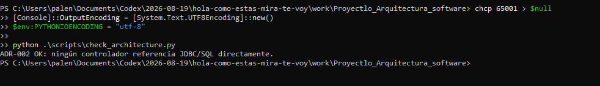](evidencias-exposicion/14-adr002-restriccion.png)

**Evidencia original:** [`evidencias-exposicion/14-adr002-restriccion.png`](evidencias-exposicion/14-adr002-restriccion.png)

---

## B. Semana 10 — Spike 1: errores reales, diagnóstico, corrección y ejecución válida

### Rama/base sincronizada

Preparación del árbol antes del Spike.

[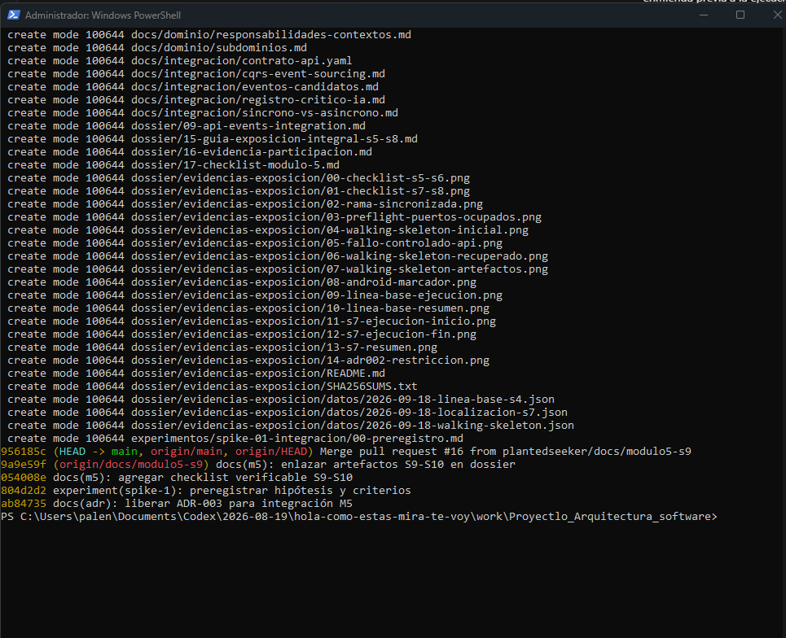](../experimentos/spike-01-integracion/evidencias/01-rama-base-sincronizada.png)

**Evidencia original:** [`../experimentos/spike-01-integracion/evidencias/01-rama-base-sincronizada.png`](../experimentos/spike-01-integracion/evidencias/01-rama-base-sincronizada.png)

---

### Docker no disponible / backend verificable

Problema de infraestructura local detectado sin confundirlo con fallo del backend.

[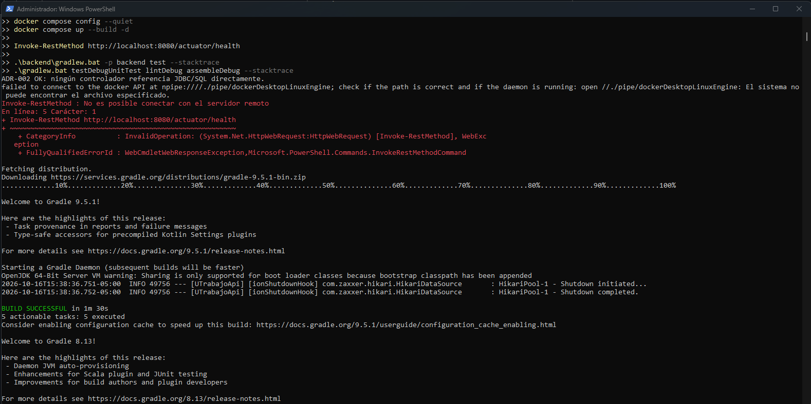](../experimentos/spike-01-integracion/evidencias/02-docker-no-disponible-backend-exitoso.png)

**Evidencia original:** [`../experimentos/spike-01-integracion/evidencias/02-docker-no-disponible-backend-exitoso.png`](../experimentos/spike-01-integracion/evidencias/02-docker-no-disponible-backend-exitoso.png)

---

### Android SDK no configurado

Error real de configuración del SDK.

[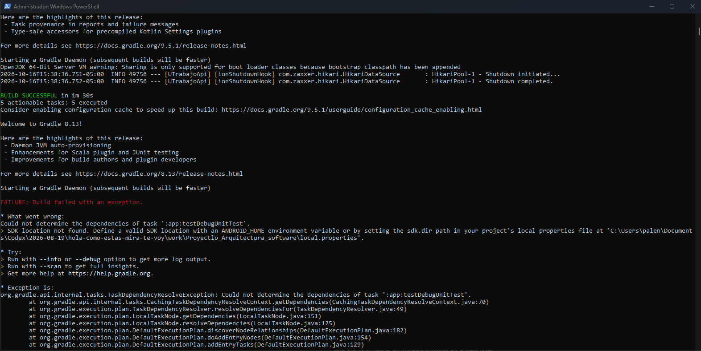](../experimentos/spike-01-integracion/evidencias/03-android-sdk-no-configurado.png)

**Evidencia original:** [`../experimentos/spike-01-integracion/evidencias/03-android-sdk-no-configurado.png`](../experimentos/spike-01-integracion/evidencias/03-android-sdk-no-configurado.png)

---

### Stacktrace Android SDK

Diagnóstico detallado del fallo de SDK.

[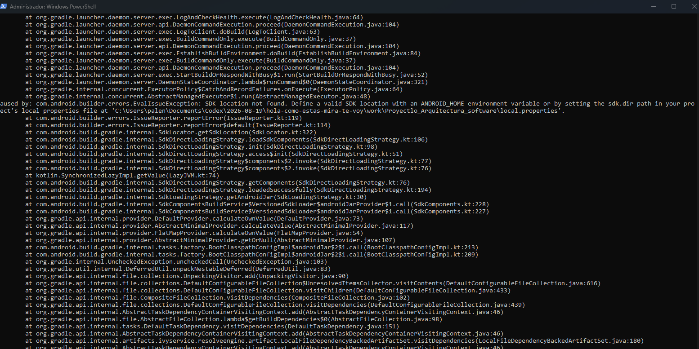](../experimentos/spike-01-integracion/evidencias/04-android-sdk-stacktrace.png)

**Evidencia original:** [`../experimentos/spike-01-integracion/evidencias/04-android-sdk-stacktrace.png`](../experimentos/spike-01-integracion/evidencias/04-android-sdk-stacktrace.png)

---

### Build Android fallido — resumen

Primer resumen visual del build fallido.

[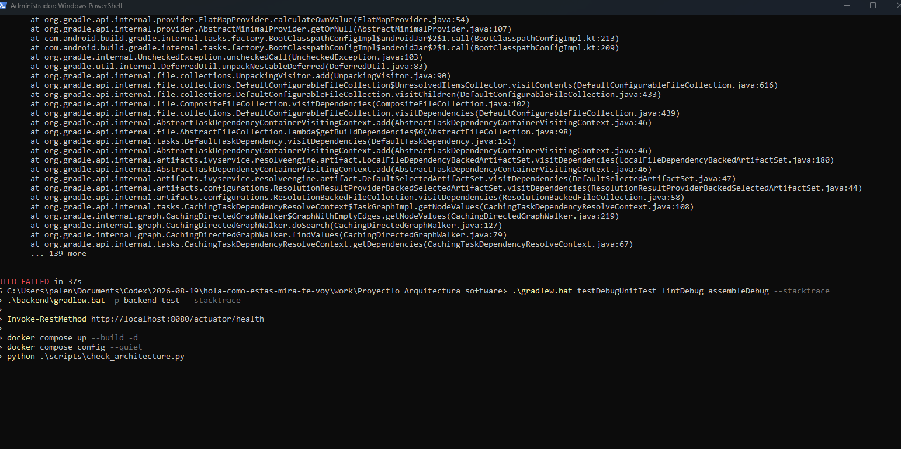](../experimentos/spike-01-integracion/evidencias/05-android-build-fallido-resumen.png)

**Evidencia original:** [`../experimentos/spike-01-integracion/evidencias/05-android-build-fallido-resumen.png`](../experimentos/spike-01-integracion/evidencias/05-android-build-fallido-resumen.png)

---

### API iniciando — health transitorio

Estado transitorio de arranque que no debía clasificarse como caída definitiva.

[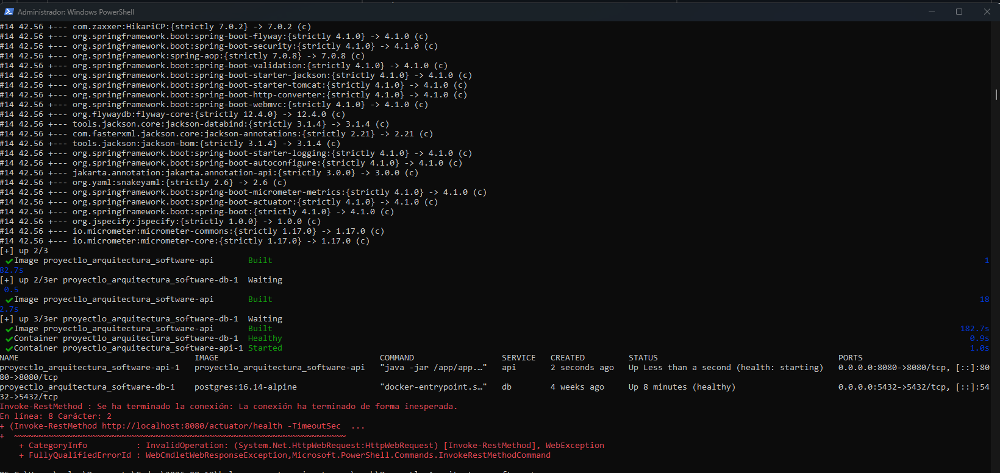](../experimentos/spike-01-integracion/evidencias/06-api-iniciando-health-transitorio.png)

**Evidencia original:** [`../experimentos/spike-01-integracion/evidencias/06-api-iniciando-health-transitorio.png`](../experimentos/spike-01-integracion/evidencias/06-api-iniciando-health-transitorio.png)

---

### Build Android fallido — estado final

Fallo previo a la corrección de lint/build.

[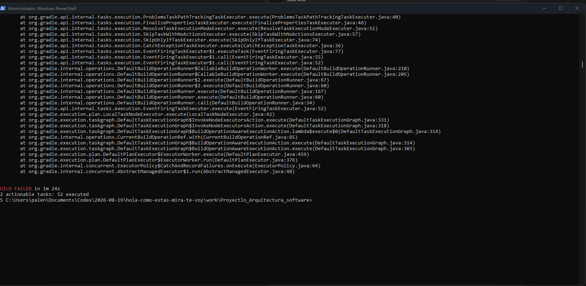](../experimentos/spike-01-integracion/evidencias/07-android-build-fallido-final.png)

**Evidencia original:** [`../experimentos/spike-01-integracion/evidencias/07-android-build-fallido-final.png`](../experimentos/spike-01-integracion/evidencias/07-android-build-fallido-final.png)

---

### Lint y build exitosos

Recuperación: lint, tests/build completados correctamente.

[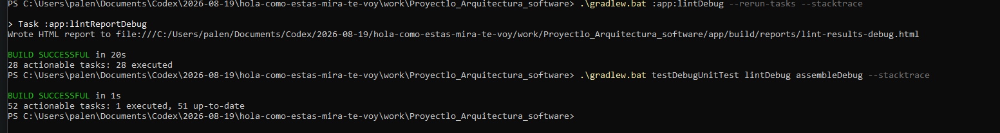](../experimentos/spike-01-integracion/evidencias/08-android-lint-y-build-exitosos.png)

**Evidencia original:** [`../experimentos/spike-01-integracion/evidencias/08-android-lint-y-build-exitosos.png`](../experimentos/spike-01-integracion/evidencias/08-android-lint-y-build-exitosos.png)

---

### Falso error por stderr de Compose

Problema del runner/PowerShell, no del fenómeno medido.

[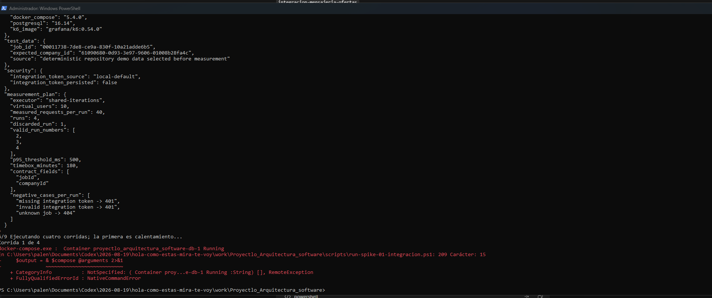](../experimentos/spike-01-integracion/evidencias/09-spike-falso-error-stderr-compose.png)

**Evidencia original:** [`../experimentos/spike-01-integracion/evidencias/09-spike-falso-error-stderr-compose.png`](../experimentos/spike-01-integracion/evidencias/09-spike-falso-error-stderr-compose.png)

---

### Spike 1 — ejecución exitosa

Ejecución válida después de corregir el entorno/instrumento.

[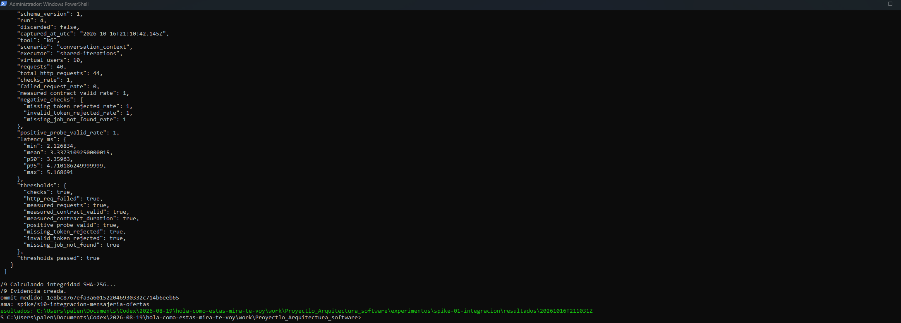](../experimentos/spike-01-integracion/evidencias/10-spike-ejecucion-exitosa.png)

**Evidencia original:** [`../experimentos/spike-01-integracion/evidencias/10-spike-ejecucion-exitosa.png`](../experimentos/spike-01-integracion/evidencias/10-spike-ejecucion-exitosa.png)

---

### Spike 1 — resumen de corridas

Resultado visual de warm-up, corridas válidas, checks y umbral.

[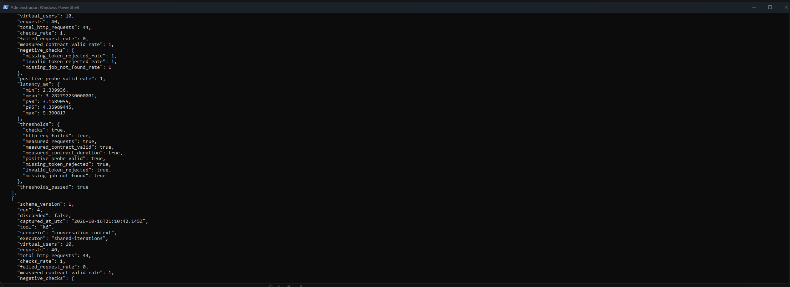](../experimentos/spike-01-integracion/evidencias/11-spike-resumen-corridas.png)

**Evidencia original:** [`../experimentos/spike-01-integracion/evidencias/11-spike-resumen-corridas.png`](../experimentos/spike-01-integracion/evidencias/11-spike-resumen-corridas.png)

---

**Log textual completo del fallo de lint:** [`../experimentos/spike-01-integracion/evidencias/12-android-lint-fallo-completo.txt`](../experimentos/spike-01-integracion/evidencias/12-android-lint-fallo-completo.txt)  
**Índice de evidencias del Spike:** [`../experimentos/spike-01-integracion/evidencias/README.md`](../experimentos/spike-01-integracion/evidencias/README.md)  
**Sellos SHA-256:** [`../experimentos/spike-01-integracion/evidencias/SHA256SUMS.txt`](../experimentos/spike-01-integracion/evidencias/SHA256SUMS.txt)

## C. Semana 11 — crecimiento y táctica de caché

### Crecimiento p95 + throughput

Visualiza el cambio de p95 y throughput al aumentar 10 → 200 VU.

[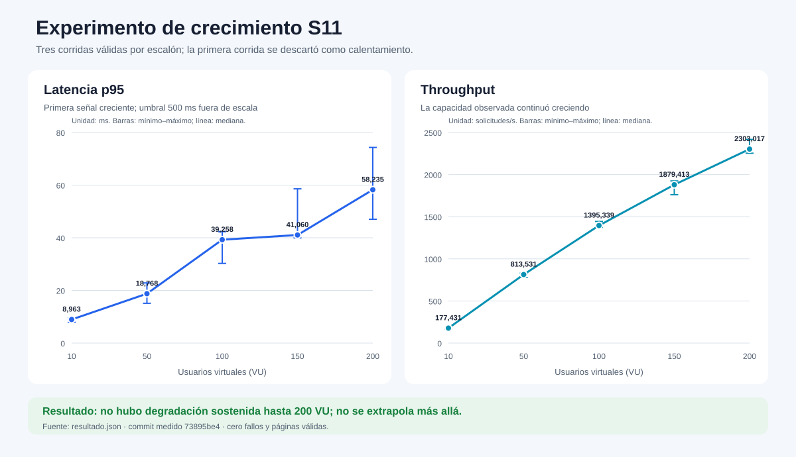](../experimentos/crecimiento-mensajeria/graficas/01-crecimiento-p95-throughput.svg)

**Evidencia original:** [`../experimentos/crecimiento-mensajeria/graficas/01-crecimiento-p95-throughput.svg`](../experimentos/crecimiento-mensajeria/graficas/01-crecimiento-p95-throughput.svg)

---

### Caché antes/después

Comparación directa del experimento de táctica.

[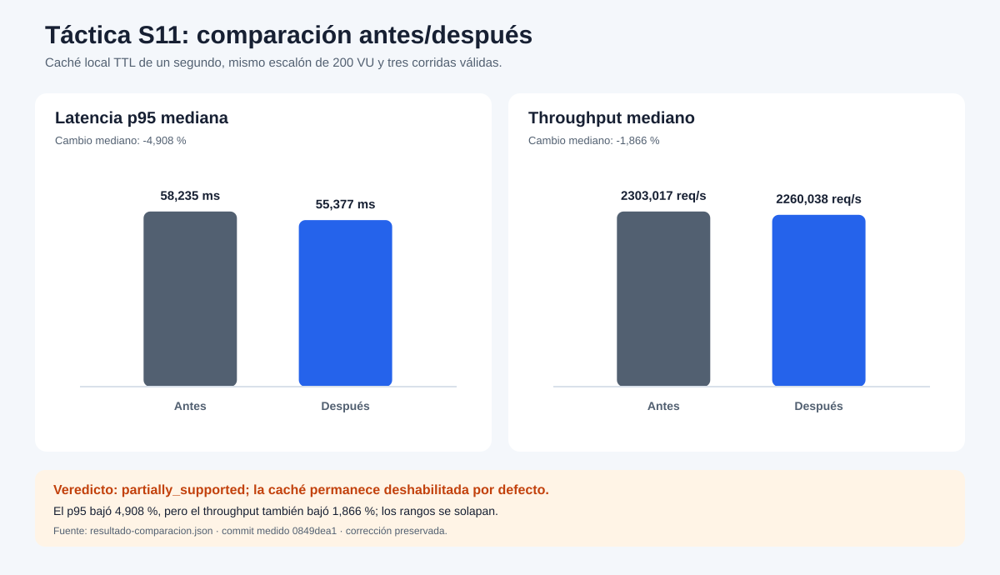](../experimentos/crecimiento-mensajeria/graficas/02-cache-antes-despues.svg)

**Evidencia original:** [`../experimentos/crecimiento-mensajeria/graficas/02-cache-antes-despues.svg`](../experimentos/crecimiento-mensajeria/graficas/02-cache-antes-despues.svg)

---

### Reejecución k6/Grafana

Evidencia visual complementaria de reejecución.

[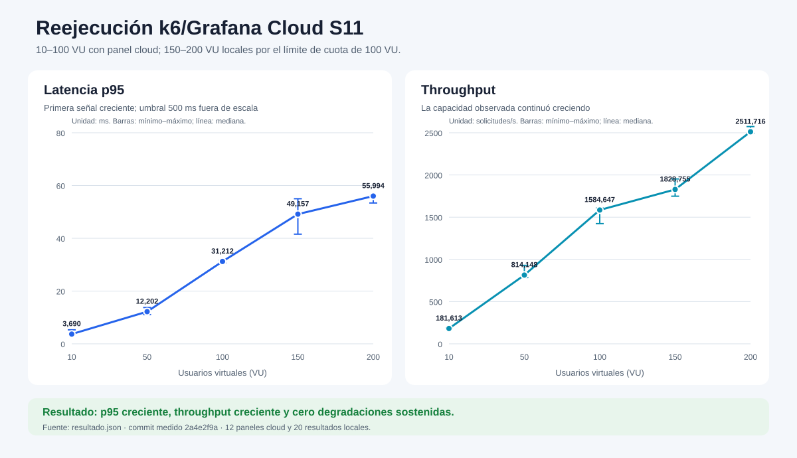](../experimentos/crecimiento-mensajeria/graficas/03-reejecucion-k6-grafana-p95-throughput.svg)

**Evidencia original:** [`../experimentos/crecimiento-mensajeria/graficas/03-reejecucion-k6-grafana-p95-throughput.svg`](../experimentos/crecimiento-mensajeria/graficas/03-reejecucion-k6-grafana-p95-throughput.svg)

---

## D. Semana 13 — seguridad

### Trust boundaries S13

Límites de confianza y superficies principales del sistema.

[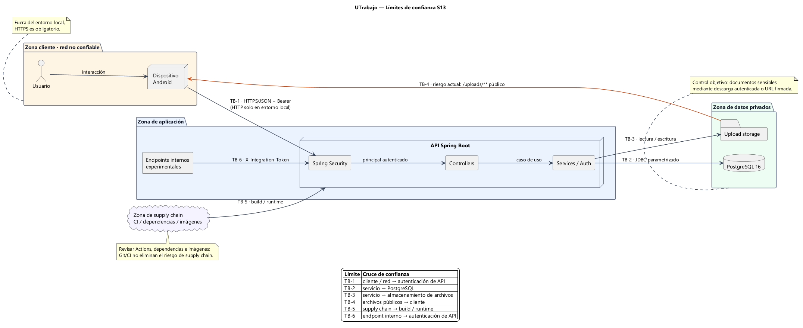](../docs/security/trust-boundaries-s13.png)

**Evidencia original:** [`../docs/security/trust-boundaries-s13.png`](../docs/security/trust-boundaries-s13.png)

---

## E. Semana 14 — despliegue conceptual

### Despliegue conceptual S14

Topología propuesta de despliegue y operación; no representa infraestructura productiva ya aprovisionada.

[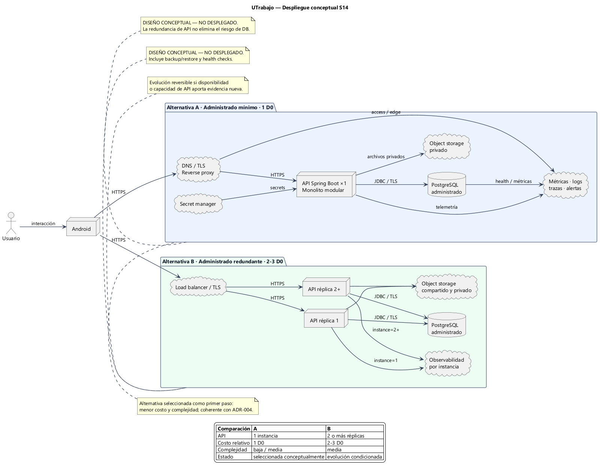](../docs/architecture/deployment-s14.png)

**Evidencia original:** [`../docs/architecture/deployment-s14.png`](../docs/architecture/deployment-s14.png)

---

## F. CI — evidencia navegable de violación y recuperación

No existe una captura PNG equivalente en el repositorio para este punto, por lo que se conserva el enlace directo a GitHub Actions, que es evidencia más fuerte que una captura estática:

- [Run #60 — el job backend detecta la violación ADR-004](https://github.com/plantedseeker/Proyectlo_Arquitectura_software/actions/runs/40039705894)
- [Documento de evidencia rojo → verde](../docs/architecture/evidencia-fitness-ci-s14.md)
- [Run #64 — estado corregido y verde](https://github.com/plantedseeker/Proyectlo_Arquitectura_software/actions/runs/40040820129)

La formulación exacta sigue siendo: el **job backend** falló por la fitness function con exit code 1; el workflow global #60 quedó después `Cancelled` por concurrencia.

---

# 1. Resumen ejecutivo del Corte 3

El tercer corte muestra una evolución continua y basada en evidencia:

~~~text
S9
Dominio + bounded contexts + contrato de integración
        ↓
S10
Spike 1 medido + veredicto + ADR-003
        ↓
S11
Carga aumentada + matriz de fallos + táctica antes/después
        ↓
S12
Alternativas de distribución + costos + ADR-004 + fitness function
        ↓
S13
Threat model + OWASP + controles + límites de confianza
        ↓
S14
Despliegue conceptual + observabilidad + riesgos + ADR-005 + CI rojo/verde
~~~

La tesis central del corte es:

> **UTrabajo conserva un monolito modular porque la evidencia disponible no demuestra una necesidad que pague la complejidad de distribuir Mensajería. En lugar de adoptar patrones por moda, el equipo hace explícitos los límites, mide hipótesis, compara costos, protege decisiones mediante CI, modela amenazas y define una evolución de despliegue observable y reversible.**

La arquitectura actual sigue siendo:

~~~text
Android
   │ HTTP/JSON + Bearer
   ▼
Spring Boot API
   │ JDBC
   ▼
PostgreSQL 16

API → almacenamiento de archivos
~~~

El Corte 3 no reemplaza la arquitectura anterior: la refina mediante fronteras de dominio, evidencia experimental, resiliencia, seguridad y operabilidad.

---

# 2. Punto de partida heredado de cortes anteriores

El Corte 3 parte de decisiones ya construidas y no comienza desde cero.

## ADR-001 — monolito modular

[ADR-001](../docs/adr/ADR-001-limites-modulo-mensajeria.md) propone mantener Mensajería dentro de la API Spring Boot como **monolito modular**.

La decisión se apoyaba en:

- un único backend;
- una sola PostgreSQL;
- autenticación, usuarios, ofertas y chats compartiendo contexto;
- ausencia de evidencia que justificara microservicios;
- línea base local de Mensajería.

## ADR-002 — límites ejecutables

[ADR-002](../docs/adr/ADR-002-limites-modulos-dependencias.md) protege una dirección de dependencias explícita:

~~~text
Android presentation
    ↓
Android data / Retrofit
    ↓
Backend controller
    ↓
Backend service / auth
    ↓
JDBC
    ↓
PostgreSQL
~~~

Regla importante:

> **Controller no debe acceder directamente a JDBC/SQL.**

Esa decisión se convirtió en fitness function mediante ArchUnit y scripts de CI.

## ADR-006 — paginación

La decisión histórica de paginación se conserva en [ADR-006](../docs/adr/ADR-006-paginacion-historial-mensajes.md).

Evidencia previa:

- página reciente: **0,120 ms**;
- `OFFSET 50000`: **102,050 ms**;
- cursor equivalente: **0,123 ms**;
- costo relativo observado: **829,675×**.

Conclusión: conservar offset para compatibilidad/página reciente, pero preparar cursor para navegación profunda si se convierte en necesidad real.

---

# 3. Semana 9 — dominio, bounded contexts e integración

## Pregunta arquitectónica

> ¿Dónde están las fronteras de dominio de UTrabajo y cómo deben comunicarse sin agregar complejidad no justificada?

Evidencia principal:

- [Semana 9 — API, eventos e integración](09-api-events-integration.md)
- [Resumen de Módulo 5](18-resumen-ejecutivo-modulo-5.md)

## 3.1 Bounded contexts identificados

Se modelaron cinco contextos lógicos:

1. **Identidad y Acceso**
2. **Perfiles**
3. **Ofertas**
4. **Postulaciones**
5. **Mensajería**

Estos contextos **no son cinco microservicios**. Son fronteras semánticas dentro del monolito modular actual.

Evidencias:

- [subdominios](../docs/dominio/subdominios.md)
- [responsabilidades y exclusiones](../docs/dominio/responsabilidades-contextos.md)
- [Context Map](../docs/dominio/context-map.md)
- [fuente PlantUML](../docs/dominio/context-map.puml)

## 3.2 Frontera elegida

La frontera estudiada fue:

~~~text
Mensajería ──consume──> Ofertas
              jobId + companyId
~~~

Motivo: para crear una conversación, Mensajería necesita comprobar la oferta y conocer la empresa propietaria.

El código As-Is ya contenía esa dependencia mediante consultas a `job_offer`, pero S9 la convirtió en una frontera explícita.

## 3.3 Alternativas de integración

Se compararon:

### A. Acceso directo al esquema compartido

Ventaja: mínimo trabajo inmediato.  
Costo: acoplamiento al esquema persistente de Ofertas.

### B. Contrato síncrono mínimo

Ventajas:

- estado actual;
- fallo explícito;
- payload pequeño;
- baja complejidad;
- alta reversibilidad.

Costo:

- dependencia temporal si los contextos algún día se distribuyen.

### C. Eventos asíncronos

Ventajas potenciales:

- menor acoplamiento temporal;
- posibilidad de proyección local.

Costos:

- consistencia eventual;
- duplicados;
- reintentos;
- idempotencia;
- publicación confiable;
- operación de broker/proyecciones.

Documento: [síncrono vs asíncrono](../docs/integracion/sincrono-vs-asincrono.md).

## 3.4 Contrato seleccionado para experimentar

[Contrato OpenAPI](../docs/integracion/contrato-api.yaml):

~~~http
GET /internal/integration/v1/jobs/{jobId}/conversation-context
X-Integration-Token: <credencial interna>
~~~

Respuesta mínima:

~~~json
{
  "jobId": "uuid",
  "companyId": "uuid"
}
~~~

Casos:

- `200`: oferta existente;
- `401`: credencial ausente/inválida;
- `404`: oferta inexistente.

Los campos `active` y `title` fueron retirados **antes de medir**, porque no eran necesarios para crear el chat.

Evidencia de la corrección previa:

[01-enmienda-previa-a-medicion.md](../experimentos/spike-01-integracion/01-enmienda-previa-a-medicion.md).

## 3.5 Eventos y uso crítico de IA

Se distinguieron hechos reales de dominio de interacciones de UI y funcionalidades inventadas.

Aceptados como candidatos:

- OfertaPublicada;
- OfertaActualizada;
- OfertaRetirada;
- PostulacionCreada;
- PostulacionCancelada;
- ChatCreado;
- MensajeEnviado.

Rechazados/inventados/redundantes:

- BotonEnviarMensajePresionado;
- PantallaChatAbierta;
- JdbcActualizado;
- MessageRead;
- NotificationSent;
- StudentHired;
- JobMatched;
- LatestMessageUpdated como evento independiente.

Evidencias:

- [eventos candidatos](../docs/integracion/eventos-candidatos.md)
- [registro crítico de IA](../docs/integracion/registro-critico-ia.md)

## 3.6 CQRS y Event Sourcing

Evaluación:

- **CQRS completo:** no justificado.
- **Event Sourcing:** no justificado.
- **Consistencia eventual:** posible para algunas proyecciones derivadas, no para autorización, persistencia del mensaje o unicidad de postulación.

Evidencia: [cqrs-event-sourcing.md](../docs/integracion/cqrs-event-sourcing.md).

## Entrega/PR de Semana 9

[PR #16 — preparar dominio, integración y preregistro S9](https://github.com/plantedseeker/Proyectlo_Arquitectura_software/pull/16)

---

# 4. Semana 10 — Spike 1 y ADR-003

## 4.1 Preregistro

Antes de implementar el spike se definieron:

- pregunta experimental;
- hipótesis;
- variable p95;
- criterios de aceptación/refutación;
- 10 VU;
- 40 solicitudes por corrida;
- cuatro corridas;
- primera corrida descartada como warm-up;
- p95 ≤ 500 ms;
- casos positivos y negativos;
- exclusión explícita de broker, CQRS completo, Event Sourcing y cambios de esquema.

Evidencia:

[00-preregistro.md](../experimentos/spike-01-integracion/00-preregistro.md).

## 4.2 Temporalidad verificable

~~~text
804d2d2  preregistro original
    <
de83109  enmienda previa a medición
    <
4b1c43d  implementación experimental
    <
1e8bc87  commit medido
    <
b2d59f1  resultados
    <
4072eba  veredicto
    <
9a62b1d  ADR-003/cierre
~~~

Esta secuencia evita construir la hipótesis después de conocer el resultado.

## 4.3 Resultado cuantitativo

Fuente autoritativa:

[resultado.json](../experimentos/spike-01-integracion/resultados/20261016T211031Z/resultado.json)

| Corrida | Uso | p95 | Checks | Fallos inesperados |
| ---: | --- | ---: | ---: | ---: |
| 1 | warm-up descartado | **5,779 ms** | 100 % | 0 % |
| 2 | válida | **4,781 ms** | 100 % | 0 % |
| 3 | válida | **4,360 ms** | 100 % | 0 % |
| 4 | válida | **4,710 ms** | 100 % | 0 % |

Corridas válidas:

- mínimo: **4,360 ms**;
- mediana: **4,710 ms**;
- máximo: **4,781 ms**;
- umbral: **500 ms**.

También pasaron:

- token ausente → 401;
- token inválido → 401;
- oferta inexistente → 404;
- contrato exacto `jobId + companyId`;
- 40 solicitudes por corrida;
- 0 fallos inesperados.

## 4.4 Veredicto

[Veredicto del spike](../experimentos/spike-01-integracion/veredicto.md):

- experimento: **válido**;
- hipótesis: **RESPALDADA** bajo las condiciones medidas;
- alcance: **AJUSTADA antes de medir**.

Lo que demuestra:

> Para esta consulta concreta y esta topología local, el contrato síncrono mínimo resolvió la necesidad sin requerir broker, proyección replicada, CQRS completo ni Event Sourcing.

Lo que **no** demuestra:

- que lo asíncrono sea universalmente peor;
- que el p95 local se cumpla en producción;
- que exista capacidad máxima medida;
- que el endpoint experimental deba convertirse en HTTP interno dentro del mismo proceso.

## 4.5 ADR-003

[ADR-003](../docs/adr/ADR-003-integracion-contextos.md) propone:

> **interacción síncrona mínima entre Mensajería y Ofertas.**

Mientras ambos contextos vivan en el mismo proceso, la implementación productiva preferida es un **puerto/interfaz interna**, no hacer que el monolito se llame a sí mismo por HTTP.

Estado:

> **Propuesta respaldada por Spike 1; pendiente de ratificación humana.**

## Entrega/PR de Semana 10

[PR #17 — validar integración síncrona Mensajería–Ofertas con Spike 1](https://github.com/plantedseeker/Proyectlo_Arquitectura_software/pull/17)

---

# 5. Semana 11 — crecimiento, fallos y resiliencia

## Pregunta

> ¿Cómo se comporta la mensajería al aumentar la concurrencia manteniendo el mismo fenómeno medido en M2?

Evidencias:

- [experimento completo](../experimentos/crecimiento-mensajeria/)
- [prerregistro](../experimentos/crecimiento-mensajeria/00-preregistro.md)
- [análisis](../experimentos/crecimiento-mensajeria/02-analisis-crecimiento.md)
- [matriz de fallos](../experimentos/crecimiento-mensajeria/03-matriz-fallos.md)
- [matriz de resiliencia](../experimentos/crecimiento-mensajeria/04-matriz-resiliencia.md)

## 5.1 Carga aumentada

Escenario conservado:

~~~text
GET /api/chats/{chatId}/messages?limit=50&offset=0
conversación extrema = 100.000 mensajes
~~~

Escalones:

| VU | Solicitudes por corrida |
| ---: | ---: |
| 10 | 40 |
| 50 | 200 |
| 100 | 400 |
| 150 | 600 |
| 200 | 800 |

Se realizaron cuatro corridas por nivel y se descartó la primera como warm-up.

Total principal: **20 corridas**.

## 5.2 Resultado de crecimiento

Fuente:

[resultado.json](../experimentos/crecimiento-mensajeria/resultados/20261016T224331Z/resultado.json)

| VU | p95 mediano |
| ---: | ---: |
| 10 | **8,963 ms** |
| 50 | **18,768 ms** |
| 100 | **39,258 ms** |
| 150 | **41,060 ms** |
| 200 | **58,235 ms** |

Interpretación correcta:

> **La latencia creció con la concurrencia, pero no se observó degradación sostenida ni saturación hasta 200 VU.**

A 200 VU:

- p95 mediano: **58,235 ms**;
- umbral: **500 ms**;
- fallos HTTP: **0**;
- páginas inválidas: **0**;
- throughput siguió creciendo.

Por eso no se afirmó que PostgreSQL, la API o k6 fueran un cuello de botella demostrado.

## 5.3 Matriz de fallos

Se analizaron hipótesis como:

- agotamiento del pool JDBC;
- PostgreSQL como límite;
- API como límite;
- k6 como límite;
- equipo compartido;
- errores/rechazos HTTP;
- contrato inválido;
- crecimiento relativo de latencia.

Regla metodológica:

> **presión observada ≠ fallo demostrado.**

## 5.4 Matriz de resiliencia

Se evaluaron:

- caché;
- timeout;
- retry;
- circuit breaker;
- bulkhead;
- aumentar pool JDBC;
- escalar API;
- SSE/WebSocket/backoff.

Como hubo 0 errores transitorios, no se presentó retry/circuit breaker como una solución ya justificada.

## 5.5 Táctica realmente probada — caché local

Protocolo:

[05-protocolo-tactica-cache.md](../experimentos/crecimiento-mensajeria/05-protocolo-tactica-cache.md)

Configuración experimental:

~~~text
TTL = 1 segundo
máximo = 1.000 entradas
solo offset = 0
autorización antes de caché
invalidación al enviar mensaje
default producción = OFF
~~~

Resultado:

[06-resultado-tactica-cache.md](../experimentos/crecimiento-mensajeria/06-resultado-tactica-cache.md)

| Métrica | Antes | Después | Cambio |
| --- | ---: | ---: | ---: |
| p95 | 58,235 ms | 55,377 ms | **-4,908 %** |
| throughput | 2.303,017 req/s | 2.260,038 req/s | **-1,866 %** |
| errores | 0 | 0 | = |
| páginas válidas | 100 % | 100 % | = |

Hits de caché: **3.196**.

Veredicto:

~~~text
partially_supported
~~~

Decisión:

> La caché **permanece deshabilitada por defecto**. La mejora de p95 no compensa de forma suficientemente clara el costo de coherencia, memoria e invalidación.

## Entrega/PR de Semana 11

[PR #20 — crecimiento de Mensajería](https://github.com/plantedseeker/Proyectlo_Arquitectura_software/pull/20)

---

# 6. Semana 12 — distribución, costos, ADR-004 y fitness function

## 6.1 Alternativas de distribución

Documento:

[alternativas-distribucion-s12.md](../docs/architecture/alternativas-distribucion-s12.md)

Se compararon:

1. mantener monolito modular;
2. réplicas del monolito;
3. microservicio síncrono de Mensajería;
4. eventos + broker + proyecciones.

## 6.2 Costos relativos S12

Se usa **C0** como unidad relativa de costo de operar la solución actual.

| Alternativa | Costo relativo | Orden aproximado |
| --- | ---: | ---: |
| Monolito modular | **1 C0** | 10^0 |
| Réplicas | **2–3 C0** | 10^0 |
| Microservicio síncrono | **4–8 C0** | 10^0–10^1 |
| Eventos + proyecciones | **8–20 C0** | 10^1 |

**C0 no representa dinero.** Es una referencia comparativa que incorpora infraestructura, operación y coordinación.

## 6.3 Auditoría de microservicios propuestos por IA

[auditoria-ia-microservicios-s12.md](../docs/architecture/auditoria-ia-microservicios-s12.md)

La IA propuso o permitió evaluar:

- extracción de Mensajería;
- extracción de Ofertas;
- broker;
- base por servicio;
- API gateway;
- discovery;
- retries;
- circuit breaker;
- caché distribuida;
- trazas;
- colas/DLQ.

La conclusión no fue “microservicios son malos”.

Fue:

> **La estrategia completa agrega complejidad que la evidencia actual no paga.**

## 6.4 ADR-004

[ADR-004](../docs/adr/ADR-004-distribucion-mensajeria.md) propone:

> **Mantener Mensajería en el monolito modular.**

Razones:

- no hubo saturación demostrada hasta 200 VU;
- p95 siguió dentro del umbral experimental;
- 0 errores;
- no existe requisito de disponibilidad independiente;
- la caché produjo beneficio parcial;
- distribución agregaría operación, fallos de red, secretos y coordinación.

Estado:

> **Propuesta respaldada por S11; pendiente de mini-comité 2.**

## 6.5 Fitness function

Documento:

[fitness-function-distribucion-s12.md](../docs/architecture/fitness-function-distribucion-s12.md)

Implementación:

[check_distribution_decision.py](../scripts/check_distribution_decision.py)

Workflow:

[ci.yml](../.github/workflows/ci.yml)

Regla:

- solo servicios Compose permitidos;
- no Kafka/RabbitMQ/Redis/Pulsar/NATS introducidos silenciosamente;
- `MESSAGE_CACHE_ENABLED=false` por defecto.

Umbral:

~~~text
0 violaciones
~~~

Resultado esperado:

~~~text
0 → CI pasa
>=1 → CI falla
~~~

## 6.6 Mini-comité

Formato:

[mini-comite-s12.md](../docs/architecture/mini-comite-s12.md)

Estado honesto:

- fuentes del ADR: completas;
- formato de comité: preparado;
- veredicto humano real: **pendiente**.

No se inventan participantes, votos ni una ratificación que no ocurrió.

## Entrega/PR de Semana 12

[PR #25 — alineación de Módulo 6](https://github.com/plantedseeker/Proyectlo_Arquitectura_software/pull/25)

---

# 7. Semana 13 — seguridad, amenazas y límites de confianza

## Objetivo

Convertir los controles dispersos del sistema en un **threat model priorizado**, usando OWASP como referencia pero sin copiar amenazas genéricas que no correspondan a UTrabajo.

Evidencia principal:

[10-seguridad.md](10-seguridad.md)

## 7.1 Activos críticos

- credenciales y sesiones;
- chats;
- CV y documentos;
- información empresarial;
- ofertas/postulaciones;
- PostgreSQL;
- configuración/secrets;
- CI/dependencias;
- evidencia experimental.

## 7.2 Límites de confianza

[SVG](../docs/security/trust-boundaries-s13.svg) · [PNG](../docs/security/trust-boundaries-s13.png) · [PlantUML](../docs/security/trust-boundaries-s13.puml)

~~~text
Android
   │
=== TB1 ===
   ▼
Spring Security → Controllers → Services
   │                         │
=== TB2 ===                === TB3 ===
   ▼                         ▼
PostgreSQL               File storage
                             │
                         === TB4 ===
                             ▼
                          /uploads

CI/dependencias === TB5
Endpoints internos === TB6
~~~

## 7.3 Controles existentes verificados

- BCrypt costo 12;
- token de sesión aleatorio;
- hash SHA-256 del token en DB;
- expiración de sesión;
- API stateless;
- autorización de participante de chat;
- roles/propiedad;
- SQL parametrizado;
- allowlists;
- límite de archivos;
- rutas normalizadas;
- restricciones DB;
- CI/ArchUnit.

## 7.4 Amenazas prioritarias

Ejemplos principales:

### T01 — acceso a chat ajeno

Riesgo alto, mitigado mediante `requireChatParticipant`.

### T02 — documentos sensibles en `/uploads/**`

Los UUID reducen descubrimiento, pero **no son autorización**.

Antes de Internet se propone:

- descarga autenticada;
- URL firmada;
- separar política de avatar vs CV/documentos sensibles.

### T03 — publicar configuración local

Riesgos:

- HTTP;
- seed demo;
- credenciales locales;
- integration token demo.

Control propuesto:

- HTTPS;
- secrets externos;
- `SEED_DEMO=false`;
- perfil de producción separado.

### T04 — falta de logging/alerting de seguridad

Health/info no bastan para detectar abuso o incidentes.

Este riesgo alimenta directamente S14.

## 7.5 Amenazas genéricas de IA descartadas o modificadas

Documento:

[auditoria-amenazas-ia-s13.md](../docs/security/auditoria-amenazas-ia-s13.md)

Ejemplos:

- XXE → no aplica actualmente: no hay procesamiento XML;
- SSRF crítico → no demostrado: no existe fetch server-side de URLs arbitrarias;
- XSS server-side como principal → no encaja con API JSON + Android Compose;
- CSRF crítico solo porque está deshabilitado → matizado por autenticación stateless Bearer;
- microservicios “por seguridad” → rechazados: no corrigen automáticamente los riesgos P0.

## Conclusión S13

> UTrabajo tiene controles verificables para laboratorio, pero **no se declara seguro para Internet**.

Prioridades antes de publicación:

1. documentos sensibles;
2. configuración y TLS/secrets;
3. logging/alerting;
4. protección de login;
5. supply chain progresivo.

## Entrega/PR de Semana 13

[PR #26 — amenazas, OWASP y límites de confianza](https://github.com/plantedseeker/Proyectlo_Arquitectura_software/pull/26)

---

# 8. Semana 14 — despliegue, observabilidad y ADR-005

## Evidencia principal

[12-despliegue-observabilidad.md](12-despliegue-observabilidad.md)

Diagrama:

[SVG](../docs/architecture/deployment-s14.svg) · [PNG](../docs/architecture/deployment-s14.png) · [PlantUML](../docs/architecture/deployment-s14.puml)

> El despliegue es **conceptual**. No se afirma que la infraestructura esté aprovisionada.

## 8.1 Alternativa A — monolito administrado mínimo

~~~text
Android
   │ HTTPS
   ▼
TLS / Reverse proxy
   ▼
1 × Spring Boot API
   ├── PostgreSQL administrado
   ├── Object storage privado
   ├── Secret manager
   └── Metrics + Logs + Traces
~~~

Costo relativo:

~~~text
1 D0
~~~

## 8.2 Alternativa B — monolito redundante

~~~text
Android
   │ HTTPS
   ▼
Load balancer
 ┌───────┴───────┐
 ▼               ▼
API 1           API 2
 └───────┬───────┘
         ▼
PostgreSQL administrado
+ object storage + observabilidad
~~~

Costo relativo:

~~~text
2–3 D0
~~~

## Diferencia entre C0 y D0

- **C0 (S12):** referencia de costo arquitectónico/operativo para comparar distribución.
- **D0 (S14):** referencia de costo de despliegue conceptual.

No son pesos/dólares ni escalas que deban mezclarse matemáticamente.

## 8.3 Observabilidad

### Métricas

- request rate;
- 5xx rate;
- p95/p99;
- JVM heap/GC/CPU;
- Hikari active/max/pending;
- DB health/latency;
- 401/403/login failures;
- storage usage/errors.

### Logs

Campos propuestos:

~~~text
timestamp
level
service
instance
requestId
traceId
spanId
route
status
duration
error.type
~~~

No registrar:

- tokens;
- contraseñas;
- contenido de chats;
- CV/documentos;
- secrets.

### Trazas

~~~text
HTTP
 ↓
Security
 ↓
Controller
 ↓
Service/Auth
 ↓
JDBC
 ↓
PostgreSQL
~~~

### Alertas iniciales

~~~text
health DOWN > 2 min       → crítica
5xx > 5 % por 5 min      → crítica
p95 > 500 ms por 5 min   → crítica
pool DB > 90 % sostenido → warning/crítica
storage > 85 %           → warning
backup fuera de política → crítica
login/403 anómalos       → seguridad
~~~

Solo el p95 de 500 ms reutiliza un criterio experimental previo; otros umbrales se declaran iniciales y sujetos a calibración.

## 8.4 Riesgos operativos

[matriz-riesgos-operativos-s14.md](../docs/architecture/matriz-riesgos-operativos-s14.md)

Incluye:

- DB no disponible;
- API caída;
- almacenamiento;
- secrets/config;
- despliegue sin TLS;
- 5xx sin alarma;
- latencia;
- Flyway;
- dependencias/imágenes;
- backup;
- crecimiento de polling;
- PII en telemetría;
- API como SPOF;
- fitness function bloqueando un cambio legítimo.

## 8.5 ADR-005

[ADR-005](../docs/adr/ADR-005-despliegue-observabilidad.md) propone:

> **Adoptar la alternativa A como primer despliegue conceptual.**

No introducir todavía:

- Kubernetes;
- broker;
- microservicios;
- redundancia de API sin SLO/evidencia.

Estado:

> **Propuesta técnica; pendiente de revisión humana.**

---

# 9. Demostración real de la fitness function — CI rojo → verde

La rúbrica pedía dejar la fitness function ejecutándose en CI y verla romper una violación.

## Violación deliberada

Se cambió temporalmente:

~~~yaml
MESSAGE_CACHE_ENABLED: ${MESSAGE_CACHE_ENABLED:-true}
~~~

cuando ADR-004 exige:

~~~yaml
MESSAGE_CACHE_ENABLED: ${MESSAGE_CACHE_ENABLED:-false}
~~~

## CI rojo

[Run #60](https://github.com/plantedseeker/Proyectlo_Arquitectura_software/actions/runs/40039705894)

El job backend falló exactamente en:

~~~text
Enforce ADR-004 distribution decision
~~~

El log registró:

~~~text
ADR-004 violado: la decisión de distribución requiere revisión explícita.
Compose debe mantener MESSAGE_CACHE_ENABLED=false por defecto.
Process completed with exit code 1.
~~~

El workflow global terminó marcado como cancelado por concurrencia de un commit posterior, pero la evidencia causal permanece: **backend ya había terminado en failure exactamente en la fitness function**.

Documento explicativo:

[evidencia-fitness-ci-s14.md](../docs/architecture/evidencia-fitness-ci-s14.md)

## Corrección

Se restauró:

~~~yaml
MESSAGE_CACHE_ENABLED: ${MESSAGE_CACHE_ENABLED:-false}
~~~

## CI verde

[Run #64](https://github.com/plantedseeker/Proyectlo_Arquitectura_software/actions/runs/40040820129)

Resultado final:

- backend: success;
- Android: success;
- ADR-002: success;
- ADR-004 fitness: success;
- tests: success.

La violación **nunca llegó a main**.

## Entrega/PR de Semana 14

[PR #27 — despliegue, observabilidad, ADR-005 y fitness CI](https://github.com/plantedseeker/Proyectlo_Arquitectura_software/pull/27)

---

# 10. Cadena de decisiones del Corte 3

| ADR | Decisión | Evidencia principal | Estado |
| --- | --- | --- | --- |
| [ADR-003](../docs/adr/ADR-003-integracion-contextos.md) | integración síncrona mínima Mensajería → Ofertas | Spike 1 S10 | propuesta respaldada; pendiente ratificación humana |
| [ADR-004](../docs/adr/ADR-004-distribucion-mensajeria.md) | mantener Mensajería en monolito modular | crecimiento S11 + costos S12 | propuesta respaldada; pendiente mini-comité 2 |
| [ADR-005](../docs/adr/ADR-005-despliegue-observabilidad.md) | primer despliegue conceptual administrado y observable | S11–S14 | propuesta técnica; pendiente revisión humana |
| [ADR-006](../docs/adr/ADR-006-paginacion-historial-mensajes.md) | cursor futuro para profundidad; offset compatible actual | evidencia S7 previa | propuesta sustentada; pendiente ratificación humana |

Lectura de continuidad:

~~~text
ADR-003
¿Cómo se comunican Mensajería y Ofertas?
        ↓
síncrono mínimo

ADR-004
¿Debemos separar Mensajería?
        ↓
no con evidencia actual

ADR-005
¿Cómo debería desplegarse/observarse si sale de local?
        ↓
monolito administrado observable

ADR-006
¿Cómo evolucionar historial profundo?
        ↓
cursor cuando exista necesidad real
~~~

---

# 11. Tabla maestra de resultados cuantitativos

| Evidencia | Resultado clave | Interpretación |
| --- | --- | --- |
| Spike 1 S10 | p95 válidos: **4,781 / 4,360 / 4,710 ms** | contrato síncrono mínimo satisface criterio local |
| Spike 1 | checks 100 %, fallos inesperados 0 % | contrato y casos 401/404 correctos |
| S11 10 VU | p95 mediano **8,963 ms** | referencia del escalón |
| S11 50 VU | **18,768 ms** | crece latencia |
| S11 100 VU | **39,258 ms** | crece latencia |
| S11 150 VU | **41,060 ms** | crecimiento se modera |
| S11 200 VU | **58,235 ms** | aún lejos del umbral 500 ms |
| S11 a 200 VU | errores 0, páginas válidas 100 % | no hubo degradación sostenida |
| Caché | p95 **-4,908 %** | ligera mejora |
| Caché | throughput **-1,866 %** | ligero deterioro |
| Caché | **3.196 hits** | la táctica sí fue utilizada |
| Caché | `partially_supported` | no habilitar por defecto |
| S12 costos | 1 C0 → 8–20 C0 | distribuir tiene costo relativo material |
| S14 despliegue | 1 D0 vs 2–3 D0 | redundancia cuesta más y queda diferida |

---

# 11.1 Evidencia visual, errores, diagnósticos, soluciones y código

> **Sí cuenta como evidencia.** Para la presentación final no solo se conserva el resultado “bonito”: también se documentan errores reales, diagnóstico, corrección y recuperación. Esto demuestra proceso técnico, trazabilidad y capacidad de reproducir/explicar lo ocurrido.

## Evidencia visual del Spike 1 — Semana 10

Índice completo:

[`experimentos/spike-01-integracion/evidencias/README.md`](../experimentos/spike-01-integracion/evidencias/README.md)

| Evidencia | Qué demuestra |
| --- | --- |
| [01-rama-base-sincronizada.png](../experimentos/spike-01-integracion/evidencias/01-rama-base-sincronizada.png) | preparación correcta de la rama/base antes del experimento |
| [02-docker-no-disponible-backend-exitoso.png](../experimentos/spike-01-integracion/evidencias/02-docker-no-disponible-backend-exitoso.png) | Docker no estaba disponible, pero backend podía verificarse por separado |
| [03-android-sdk-no-configurado.png](../experimentos/spike-01-integracion/evidencias/03-android-sdk-no-configurado.png) | error real de configuración del Android SDK |
| [04-android-sdk-stacktrace.png](../experimentos/spike-01-integracion/evidencias/04-android-sdk-stacktrace.png) | diagnóstico completo del fallo de SDK |
| [05-android-build-fallido-resumen.png](../experimentos/spike-01-integracion/evidencias/05-android-build-fallido-resumen.png) | primer cierre fallido del build Android |
| [06-api-iniciando-health-transitorio.png](../experimentos/spike-01-integracion/evidencias/06-api-iniciando-health-transitorio.png) | estado transitorio `health: starting`, evitando confundirlo con caída definitiva |
| [07-android-build-fallido-final.png](../experimentos/spike-01-integracion/evidencias/07-android-build-fallido-final.png) | fallo Android antes de corregir lint |
| [08-android-lint-y-build-exitosos.png](../experimentos/spike-01-integracion/evidencias/08-android-lint-y-build-exitosos.png) | recuperación: lint, tests y build exitosos |
| [09-spike-falso-error-stderr-compose.png](../experimentos/spike-01-integracion/evidencias/09-spike-falso-error-stderr-compose.png) | error del instrumento: PowerShell interpretó stderr normal de Compose como fallo |
| [10-spike-ejecucion-exitosa.png](../experimentos/spike-01-integracion/evidencias/10-spike-ejecucion-exitosa.png) | ejecución final completa del spike |
| [11-spike-resumen-corridas.png](../experimentos/spike-01-integracion/evidencias/11-spike-resumen-corridas.png) | resumen visual de corridas, checks y umbrales |
| [12-android-lint-fallo-completo.txt](../experimentos/spike-01-integracion/evidencias/12-android-lint-fallo-completo.txt) | log textual completo del error lint antes de la corrección |
| [SHA256SUMS.txt](../experimentos/spike-01-integracion/evidencias/SHA256SUMS.txt) | integridad de las evidencias visuales |

### Secuencia visual recomendada para explicar “error → solución”

~~~text
03 SDK no configurado
    ↓
04 stacktrace
    ↓
05/07 build fallido
    ↓
08 lint + build exitosos

09 falso error del runner
    ↓
corrección del tratamiento de stderr
    ↓
10 ejecución exitosa
    ↓
11 resumen de corridas
~~~

Estas capturas **no reemplazan** los JSON/logs/NDJSON del experimento. Los complementan. La fuente cuantitativa autoritativa sigue siendo [resultado.json](../experimentos/spike-01-integracion/resultados/20261016T211031Z/resultado.json).

## Gráficas visuales de Semana 11

| Gráfica | Uso en la exposición |
| --- | --- |
| [Crecimiento p95 + throughput](../experimentos/crecimiento-mensajeria/graficas/01-crecimiento-p95-throughput.svg) | mostrar visualmente cómo aumenta la latencia con los VU sin afirmar saturación |
| [Caché antes/después](../experimentos/crecimiento-mensajeria/graficas/02-cache-antes-despues.svg) | comparar p95 y throughput antes/después de la táctica |
| [Reejecución k6/Grafana](../experimentos/crecimiento-mensajeria/graficas/03-reejecucion-k6-grafana-p95-throughput.svg) | evidencia visual complementaria de la reejecución |
| [README de gráficas](../experimentos/crecimiento-mensajeria/graficas/README.md) | contexto, procedencia y lectura correcta |

## Diagramas renderizados que sí conviene mostrar

### Seguridad S13

- [Trust boundaries — SVG](../docs/security/trust-boundaries-s13.svg)
- [Trust boundaries — PNG](../docs/security/trust-boundaries-s13.png)
- [Fuente PlantUML](../docs/security/trust-boundaries-s13.puml)

### Despliegue S14

- [Despliegue conceptual — SVG](../docs/architecture/deployment-s14.svg)
- [Despliegue conceptual — PNG](../docs/architecture/deployment-s14.png)
- [Fuente PlantUML](../docs/architecture/deployment-s14.puml)

## Evidencia visual de CI — violación y recuperación

- [Run #60 — violación detectada por fitness function](https://github.com/plantedseeker/Proyectlo_Arquitectura_software/actions/runs/40039705894)
- [Documento explicativo rojo → verde](../docs/architecture/evidencia-fitness-ci-s14.md)
- [Run #64 — estado corregido y verde](https://github.com/plantedseeker/Proyectlo_Arquitectura_software/actions/runs/40040820129)

Secuencia:

~~~text
configuración permitida
    ↓
violación deliberada
    ↓
Enforce ADR-004 distribution decision = FAILURE
    ↓
corrección
    ↓
backend + Android + fitness = SUCCESS
~~~

## Evidencia de código — fuente directa

Para código, el enlace directo al archivo es más fuerte que una captura porque el profesor puede revisar el contenido real versionado.

| Tema | Código |
| --- | --- |
| Seguridad HTTP | [SecurityConfig.kt](../backend/src/main/kotlin/com/tab/utrabajo/api/config/SecurityConfig.kt) |
| Resolución/seguridad de sesión | [AuthService.kt](../backend/src/main/kotlin/com/tab/utrabajo/api/auth/AuthService.kt) |
| Casos de uso y `requireChatParticipant` | [UTrabajoService.kt](../backend/src/main/kotlin/com/tab/utrabajo/api/service/UTrabajoService.kt) |
| Almacenamiento/validación de archivos | [FileStorageService.kt](../backend/src/main/kotlin/com/tab/utrabajo/api/service/FileStorageService.kt) |
| Contrato experimental | [JobIntegrationController.kt](../backend/src/main/kotlin/com/tab/utrabajo/api/controller/JobIntegrationController.kt) |
| Autenticador del contrato experimental | [IntegrationTokenAuthenticator.kt](../backend/src/main/kotlin/com/tab/utrabajo/api/auth/IntegrationTokenAuthenticator.kt) |
| Servicio de integración | [JobIntegrationService.kt](../backend/src/main/kotlin/com/tab/utrabajo/api/service/JobIntegrationService.kt) |
| Fitness ADR-004 | [check_distribution_decision.py](../scripts/check_distribution_decision.py) |
| Workflow real | [ci.yml](../.github/workflows/ci.yml) |
| Configuración de despliegue local | [docker-compose.yml](../docker-compose.yml) |

## Evidencia histórica de fallos/recuperación previa

El repositorio también conserva capturas de cortes anteriores en
[`dossier/evidencias-exposicion/`](evidencias-exposicion/). Aunque no son el núcleo de S9–S14, sirven si el profesor pregunta por continuidad del método experimental:

- [fallo controlado de API](evidencias-exposicion/05-fallo-controlado-api.png);
- [walking skeleton recuperado](evidencias-exposicion/06-walking-skeleton-recuperado.png);
- [artefactos del walking skeleton](evidencias-exposicion/07-walking-skeleton-artefactos.png);
- [ejecución de línea base](evidencias-exposicion/09-linea-base-ejecucion.png);
- [resumen línea base](evidencias-exposicion/10-linea-base-resumen.png);
- [restricción ADR-002](evidencias-exposicion/14-adr002-restriccion.png).

### Lectura correcta

Estas imágenes son **evidencia complementaria**. El orden de fuerza para defender una afirmación es:

~~~text
código/versionado + JSON/logs/resultados
            ↓
PR/commits/CI
            ↓
capturas y diagramas
            ↓
explicación oral
~~~

La captura ayuda a contar la historia; el artefacto versionado permite auditarla.

---

# 12. Trazabilidad de PR del Corte 3

| Semana/bloque | PR | Resultado |
| --- | --- | --- |
| S9 | [PR #16](https://github.com/plantedseeker/Proyectlo_Arquitectura_software/pull/16) | dominio, integración, preregistro |
| S10 | [PR #17](https://github.com/plantedseeker/Proyectlo_Arquitectura_software/pull/17) | Spike 1, resultados, veredicto, ADR-003 |
| S11 | [PR #20](https://github.com/plantedseeker/Proyectlo_Arquitectura_software/pull/20) | crecimiento, fallos, resiliencia, caché |
| S12 | [PR #25](https://github.com/plantedseeker/Proyectlo_Arquitectura_software/pull/25) | distribución, costos, ADR-004, fitness |
| S13 | [PR #26](https://github.com/plantedseeker/Proyectlo_Arquitectura_software/pull/26) | seguridad, OWASP, trust boundaries |
| S14 | [PR #27](https://github.com/plantedseeker/Proyectlo_Arquitectura_software/pull/27) | despliegue, observabilidad, ADR-005, CI rojo/verde |
| Navegación | [PR #28](https://github.com/plantedseeker/Proyectlo_Arquitectura_software/pull/28) | resumen S13–S14 convertido en guía clicable |
| Tutor M6 | [PR #29](https://github.com/plantedseeker/Proyectlo_Arquitectura_software/pull/29) | uso crítico del Tutor A1–A6 |

Esta tabla sirve para diferenciar:

- **artefacto técnico**;
- **historial Git**;
- **actividad humana**.

Las revisiones y ratificaciones no se atribuyen retroactivamente a integrantes sin evidencia.

---

# 13. Uso crítico del Tutor y de IA

Documento específico:

[23-tarea-2-uso-critico-tutor-modulo-6.md](23-tarea-2-uso-critico-tutor-modulo-6.md)

Principios aplicados:

1. una recomendación no se acepta por sonar avanzada;
2. se contrasta contra código, métricas y contexto;
3. se distingue “propuesta” de “resultado medido”;
4. se conservan hipótesis antes de ejecutar;
5. una hipótesis refutada también sería válida;
6. no se inventan comités, votos o producción inexistente.

Ejemplos de recomendaciones rechazadas/condicionadas:

| Idea | Decisión |
| --- | --- |
| “Latencia creció → PostgreSQL se saturó” | rechazada: no hay evidencia causal |
| “Retry porque aparece en resiliencia” | rechazada: 0 errores transitorios |
| “Caché mejoró p95 → habilitarla” | rechazada: throughput empeoró y beneficio fue parcial |
| “Microservicios por escalabilidad” | diferida: no existe presión que pague el costo |
| “SSRF/XXE críticos porque están en listas” | descartados actualmente por falta de superficie real |
| “Marcar comité aprobado” | rechazado: veredicto humano pendiente |

---

# 14. Matriz de cumplimiento por semana

| Semana | Requisito central | Estado |
| --- | --- | --- |
| **9** | dominio/contextos | ✅ |
| 9 | contrato/API o eventos | ✅ |
| 9 | sync vs async | ✅ |
| 9 | filtro crítico de IA/eventos | ✅ |
| 9 | preregistro Spike 1 | ✅ |
| **10** | spike en rama separada | ✅ |
| 10 | condiciones/resultados/veredicto | ✅ |
| 10 | ADR-003 | ✅ documental; ratificación humana pendiente |
| 10 | evaluación CQRS/consistencia eventual | ✅ |
| **11** | M2 con carga aumentada | ✅ |
| 11 | registrar degradación | ✅: crecimiento de latencia, sin saturación sostenida |
| 11 | matriz fallos/resiliencia | ✅ |
| 11 | táctica antes/después | ✅ |
| **12** | costos de distribución | ✅ |
| 12 | ADR-004 | ✅ documental; mini-comité pendiente |
| 12 | fitness function | ✅ |
| 12 | auditoría microservicios IA | ✅ |
| 12 | defensa preparada | ✅ |
| **13** | OWASP/threat model | ✅ |
| 13 | seguridad del sistema completo | ✅ |
| 13 | controles + trust boundaries | ✅ |
| 13 | filtrar amenazas genéricas | ✅ |
| **14** | despliegue conceptual | ✅ |
| 14 | dos alternativas + costos | ✅ |
| 14 | métricas/logs/trazas/alertas | ✅ |
| 14 | observabilidad ↔ fallos | ✅ |
| 14 | fitness function rompe CI | ✅ |
| 14 | ADR-005 + matriz operativa | ✅ |

---

# 15. Lo que el Corte 3 demuestra y lo que NO demuestra

## Sí demuestra

- que el sistema tiene bounded contexts lógicos defendibles;
- que la frontera Mensajería → Ofertas fue explicitada y medida;
- que el contrato síncrono cumplió su criterio experimental local;
- que la carga aumentada produjo crecimiento de latencia sin saturación sostenida hasta 200 VU;
- que la caché produjo un beneficio parcial y por eso quedó apagada;
- que la distribución fue evaluada con costo/reversibilidad;
- que la regla de distribución está automatizada en CI;
- que una violación real detiene el backend;
- que existe un modelo de amenazas basado en el sistema real;
- que existe un diseño conceptual de despliegue/observabilidad y riesgos.

## No demuestra

- capacidad máxima de producción;
- SLA/SLO de Internet;
- alta disponibilidad desplegada;
- que microservicios nunca serán necesarios;
- que la infraestructura S14 ya existe;
- que todos los ADR fueron ratificados humanamente;
- que el mini-comité 2 ya emitió veredicto;
- que UTrabajo “cumple OWASP” de forma certificada;
- que 200 VU equivalen a 200 requests/s.

---

# 16. Recorrido recomendado para la presentación final

## Versión de 12–15 minutos

| Tiempo | Tema | Evidencia clicable |
| ---: | --- | --- |
| 0:00–1:00 | tesis y arquitectura actual | [este informe](informe-final.md) |
| 1:00–2:30 | S9: bounded contexts + Context Map | [M5](18-resumen-ejecutivo-modulo-5.md), [Context Map](../docs/dominio/context-map.md) |
| 2:30–4:00 | S10: Spike 1 y resultado | [resultado](../experimentos/spike-01-integracion/resultados/20261016T211031Z/resultado.json), [veredicto](../experimentos/spike-01-integracion/veredicto.md) |
| 4:00–5:00 | ADR-003 | [ADR-003](../docs/adr/ADR-003-integracion-contextos.md) |
| 5:00–7:00 | S11: crecimiento + caché | [resumen S11–S12](19-resumen-ejecutivo-s11-s12.md), [resultado](../experimentos/crecimiento-mensajeria/resultados/20261016T224331Z/resultado.json) |
| 7:00–8:30 | S12: distribución/costos | [alternativas](../docs/architecture/alternativas-distribucion-s12.md), [ADR-004](../docs/adr/ADR-004-distribucion-mensajeria.md) |
| 8:30–9:30 | fitness function | [regla](../docs/architecture/fitness-function-distribucion-s12.md) |
| 9:30–11:00 | S13: seguridad | [10-seguridad](10-seguridad.md), [trust boundaries](../docs/security/trust-boundaries-s13.svg) |
| 11:00–12:30 | S14: despliegue/observabilidad | [12-despliegue](12-despliegue-observabilidad.md), [diagrama](../docs/architecture/deployment-s14.svg) |
| 12:30–13:30 | ADR-005 + riesgos | [ADR-005](../docs/adr/ADR-005-despliegue-observabilidad.md), [riesgos](../docs/architecture/matriz-riesgos-operativos-s14.md) |
| 13:30–14:30 | CI rojo → verde | [run rojo](https://github.com/plantedseeker/Proyectlo_Arquitectura_software/actions/runs/40039705894), [run verde](https://github.com/plantedseeker/Proyectlo_Arquitectura_software/actions/runs/40040820129) |
| 14:30–15:00 | conclusión | [matriz de cumplimiento](#14-matriz-de-cumplimiento-por-semana) |

## Historia oral resumida

> En el Corte 3 empezamos haciendo explícitos los contextos de negocio y la frontera Mensajería–Ofertas. No asumimos que eventos fueran mejores: preregistramos un spike y medimos un contrato síncrono mínimo. Como cumplió el umbral local sin errores, ADR-003 mantiene esa interacción simple. Después aumentamos la carga de Mensajería hasta 200 VU. La latencia creció, pero no apareció saturación sostenida ni errores, y una caché solo produjo beneficio parcial. Con esa evidencia comparamos alternativas de distribución y ADR-004 mantiene el monolito modular. Luego modelamos amenazas reales, no listas genéricas, y finalmente diseñamos un despliegue administrado observable. La decisión no queda solo en documentos: una fitness function protege la arquitectura y demostramos que una violación real rompe CI antes de poder fusionarse.

---

# 17. Preguntas probables de defensa final

## ¿Por qué sigue siendo monolito modular?

Porque no existe evidencia de una necesidad de escalado, disponibilidad o despliegue independiente que compense la complejidad de microservicios. La modularidad sí se protege con límites ejecutables.

## ¿Qué diferencia hay entre bounded context y microservicio?

Bounded context es una frontera semántica/modelo. Microservicio es una decisión de despliegue y operación. En UTrabajo los contextos son lógicos dentro de un único proceso.

## ¿Por qué Mensajería depende de Ofertas?

Crear un chat necesita saber si la oferta existe y qué empresa la posee. El objetivo del contrato es limitar esa dependencia a `jobId + companyId`.

## ¿Por qué síncrono y no eventos?

El spike mostró que la consulta síncrona satisface la necesidad actual. Los eventos agregan proyección, duplicados, idempotencia, reintentos y consistencia eventual sin beneficio demostrado para este caso.

## ¿Qué es p95?

Es el valor por debajo del cual se encuentra aproximadamente el 95 % de las observaciones de latencia de la corrida.

## ¿Qué es un VU?

Virtual User en k6. Representa un usuario virtual concurrente que ejecuta el escenario. **No equivale a requests/s.**

## ¿Qué pasó al subir de 10 a 200 VU?

El p95 mediano subió de 8,963 a 58,235 ms, pero permaneció bajo 500 ms, con 0 fallos HTTP y páginas correctas. Se observó presión de latencia, no saturación sostenida.

## ¿Por qué no retry?

No hubo fallos transitorios que justificaran retry. Agregar reintentos sin esa evidencia podría amplificar presión.

## ¿Por qué la caché no quedó activa?

Porque el p95 mejoró 4,908 %, pero el throughput empeoró 1,866 % y los rangos se solaparon. El veredicto fue parcial.

## ¿Qué significa C0?

Unidad relativa de costo para comparar alternativas de distribución en S12. No es dinero.

## ¿Qué significa D0?

Unidad relativa de costo del despliegue conceptual S14. Tampoco es dinero y no debe confundirse con C0.

## ¿La app cumple OWASP?

No se afirma eso. Se usó OWASP como referencia para modelar amenazas aplicables y controles/riesgos residuales.

## ¿Cuál fue un riesgo real importante?

La política actual de `/uploads/**` merece endurecimiento antes de Internet porque puede contener documentos sensibles; UUID no equivale a autorización.

## ¿Qué es la fitness function?

Una regla ejecutable que protege una decisión arquitectónica. Si alguien introduce una violación, CI falla.

## ¿Cómo demostraron que funciona?

Se activó deliberadamente la caché por defecto en una rama; el backend falló en `Enforce ADR-004 distribution decision`. Se corrigió y luego CI quedó verde.

## ¿El despliegue de S14 ya está funcionando en la nube?

No. Es una decisión/diseño conceptual. El informe lo declara explícitamente.

---

# 18. Pendientes humanos que no deben ocultarse

El repositorio mantiene pendientes de ratificación/revisión cuando corresponde:

- ADR-003: ratificación humana;
- ADR-004: mini-comité 2;
- ADR-005: revisión humana;
- ADR-006: ratificación humana;
- defensa oral final.

Eso no invalida la evidencia técnica. Evita atribuir decisiones humanas que todavía no están registradas.

---

# 19. Glosario para exposición

| Término | Significado en UTrabajo |
| --- | --- |
| **VU** | Virtual User de k6; concurrencia simulada |
| **p95** | percentil 95 de latencia |
| **throughput** | solicitudes procesadas por unidad de tiempo |
| **bounded context** | frontera semántica de modelo/responsabilidad |
| **ADR** | registro de decisión arquitectónica |
| **Spike** | experimento técnico acotado para reducir incertidumbre |
| **preregistro** | hipótesis/criterios escritos antes de medir |
| **fitness function** | regla automática que protege una propiedad arquitectónica |
| **CQRS** | separación de modelos de comando y consulta |
| **Event Sourcing** | estado reconstruido desde historial de eventos |
| **consistencia eventual** | copias/proyecciones convergen con retraso |
| **C0** | costo relativo base de distribución S12 |
| **D0** | costo relativo base de despliegue S14 |
| **trust boundary** | frontera donde cambia el nivel de confianza |
| **SLO experimental** | umbral usado para evaluar una prueba, no promesa de producción |

---

# 20. Conclusión final

El tercer corte de UTrabajo no consistió en agregar tecnologías por acumulación. Consistió en **reducir incertidumbre y convertir decisiones arquitectónicas en evidencia verificable**.

El recorrido completo muestra:

~~~text
modelo de dominio
    ↓
frontera explícita
    ↓
hipótesis
    ↓
experimento
    ↓
resultado
    ↓
ADR
    ↓
carga aumentada
    ↓
fallos y resiliencia
    ↓
comparación de distribución
    ↓
fitness function
    ↓
seguridad
    ↓
despliegue y observabilidad
~~~

La conclusión arquitectónica actual es coherente en todo el corte:

> **Mantener UTrabajo como monolito modular, reforzar sus límites internos, utilizar integración simple mientras la evidencia lo permita, no distribuir Mensajería prematuramente, cerrar riesgos de seguridad antes de exponer el sistema a Internet y preparar un despliegue administrado observable y reversible.**

La fortaleza principal no es que todas las decisiones hayan resultado “sí”. Varias propuestas —microservicios, broker, CQRS completo, Event Sourcing, retry o caché por defecto— fueron **diferidas o rechazadas porque la evidencia no justificó su costo**.

Eso es precisamente el hilo conductor del Corte 3:

> **medir primero, decidir después y automatizar las decisiones que deban mantenerse en el tiempo.**

---

# 21. Últimos enlaces para la presentación

- [Repositorio UTrabajo](https://github.com/plantedseeker/Proyectlo_Arquitectura_software)
- [Dossier](https://github.com/plantedseeker/Proyectlo_Arquitectura_software/tree/main/dossier)
- [Resumen Módulo 5](18-resumen-ejecutivo-modulo-5.md)
- [Resumen S11–S12](19-resumen-ejecutivo-s11-s12.md)
- [Resumen S13–S14](22-resumen-ejecutivo-s13-s14.md)
- [Uso crítico del Tutor](23-tarea-2-uso-critico-tutor-modulo-6.md)
- [PR #16](https://github.com/plantedseeker/Proyectlo_Arquitectura_software/pull/16)
- [PR #17](https://github.com/plantedseeker/Proyectlo_Arquitectura_software/pull/17)
- [PR #20](https://github.com/plantedseeker/Proyectlo_Arquitectura_software/pull/20)
- [PR #25](https://github.com/plantedseeker/Proyectlo_Arquitectura_software/pull/25)
- [PR #26](https://github.com/plantedseeker/Proyectlo_Arquitectura_software/pull/26)
- [PR #27](https://github.com/plantedseeker/Proyectlo_Arquitectura_software/pull/27)
- [CI rojo](https://github.com/plantedseeker/Proyectlo_Arquitectura_software/actions/runs/40039705894)
- [CI verde](https://github.com/plantedseeker/Proyectlo_Arquitectura_software/actions/runs/40040820129)

