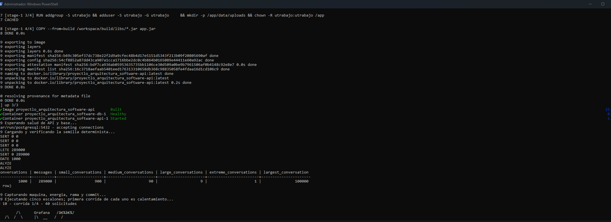
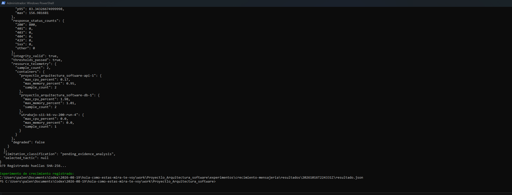
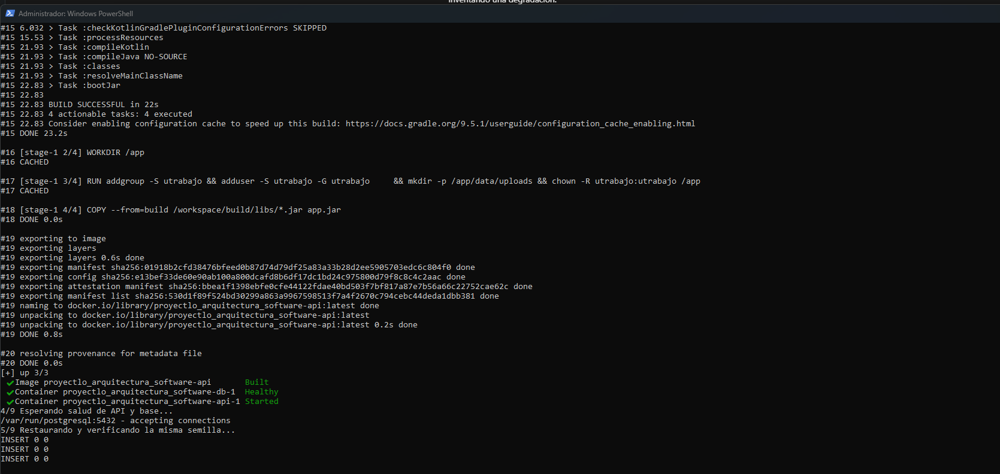
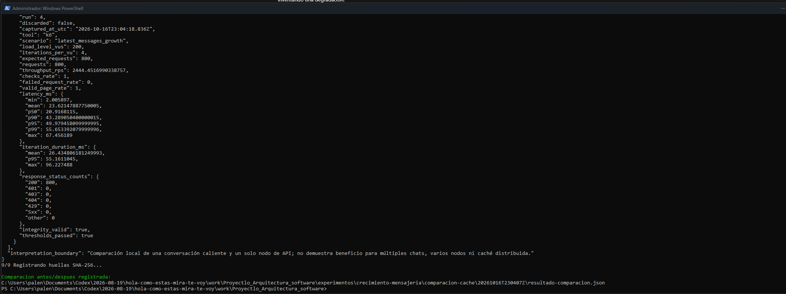

# Capturas de ejecución — S11

Estas capturas complementan la defensa visual del experimento. No sustituyen
los JSON, logs, contexto ni `SHA256SUMS.txt`, que son la evidencia primaria y
reproducible.

| Captura | Qué permite comprobar |
| --- | --- |
| `01-crecimiento-cierre-y-huellas.png` | cierre del crecimiento, registro del resultado y cálculo de huellas |
| `02-crecimiento-construccion-semilla-inicio.png` | construcción de la imagen, contenedores saludables, semilla y comienzo de escalones |
| `03-cache-construccion-y-semilla.png` | compilación exitosa, reconstrucción de la API y restauración de la misma semilla para el después |
| `04-cache-cierre-y-huellas.png` | corrida final, límites de interpretación, huellas y ruta del resultado antes/después |

## Integridad de las capturas recibidas

| Archivo | SHA-256 |
| --- | --- |
| `01-crecimiento-cierre-y-huellas.png` | `9da5fe39b846fc6ce9bc47b2a17d2d3f81f4d1292964da39956ad188bd592c86` |
| `02-crecimiento-construccion-semilla-inicio.png` | `b87694a53e846c0ceb6ccb1b685df8635f6e4dda55647441a8ff04f0190572b8` |
| `03-cache-construccion-y-semilla.png` | `bb34199c260431e07dd7b770e76b4ec531eb4d6451196693b2cd0b795e3dff20` |
| `04-cache-cierre-y-huellas.png` | `dac8d6a89990f35d149d2b874661b588661c477024ca8286badac6b65118cf64` |

## Secuencia visual

### Crecimiento: inicio

### Crecimiento: cierre

### Táctica: construcción y condiciones

### Táctica: cierre

