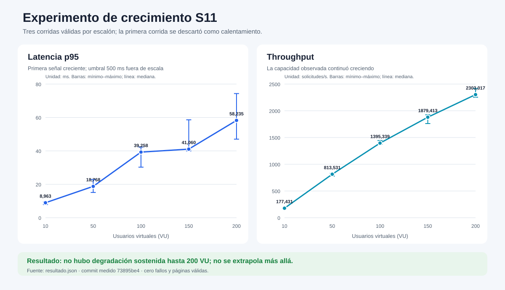
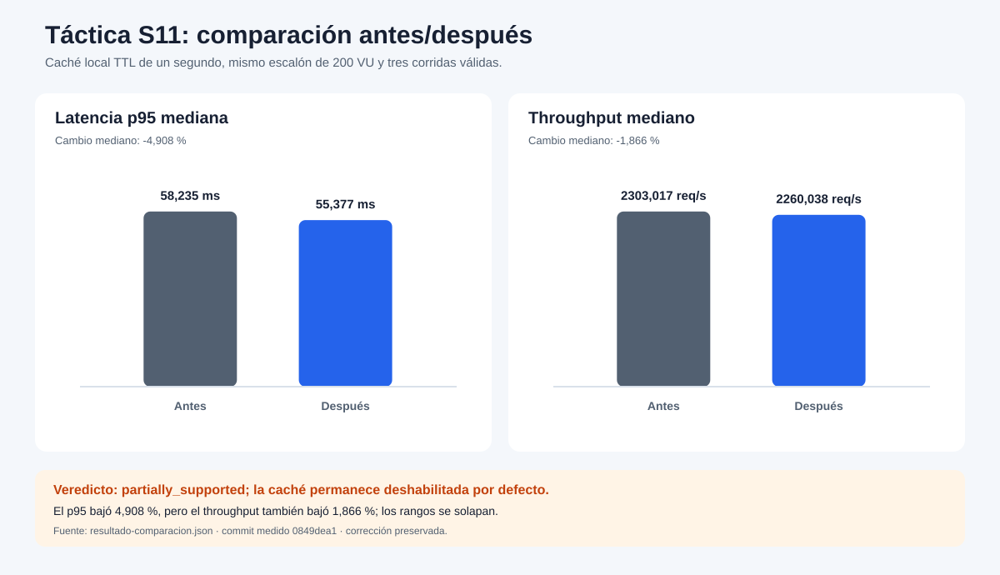
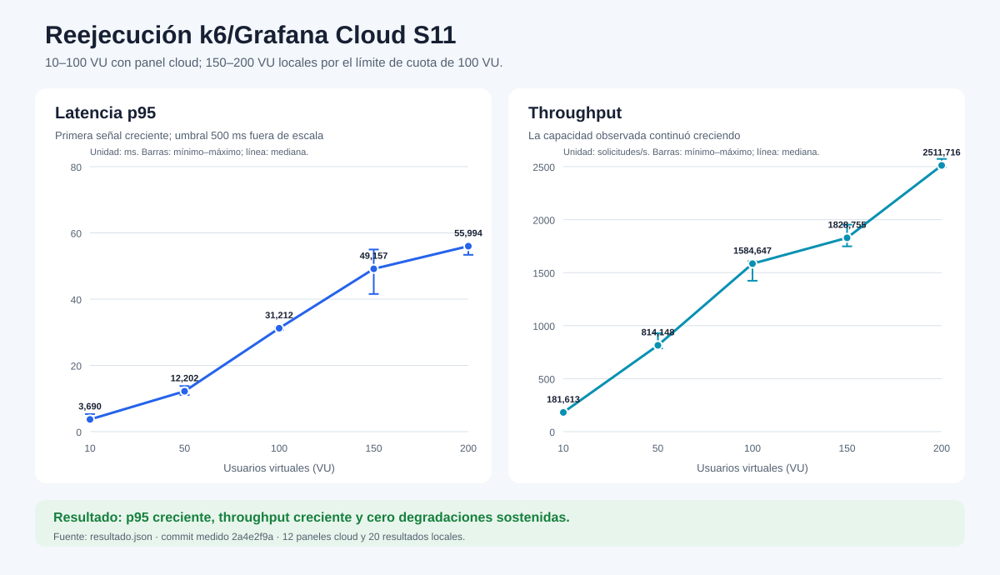

# Gráficas reproducibles — S11

Estas curvas se generan exclusivamente desde los JSON versionados del
experimento. No sustituyen los datos primarios ni agregan mediciones.

## Evidencia visual

### Crecimiento por escalones



Fuente:
[`resultado.json`](../resultados/20261016T224331Z/resultado.json).

### Táctica antes/después



Fuente:
[`resultado-comparacion.json`](../comparacion-cache/20261016T230407Z/resultado-comparacion.json).

### Reejecución k6 con Grafana Cloud



Fuente:
[`resultado.json`](../resultados/20261023T215929Z/resultado.json) e
[`índice de paneles Grafana Cloud`](../grafana-cloud/ultima-ejecucion.md).

Los escalones de 10, 50 y 100 VU tienen cuatro paneles interactivos de
Grafana Cloud cada uno. Los escalones de 150 y 200 VU se ejecutaron y
versionaron localmente porque la cuota del proyecto cloud está limitada a
100 VU; la gráfica mantiene los cinco escalones y deja visible esa diferencia.

## Reproducción

Desde la raíz del repositorio:

```powershell
python .\experimentos\crecimiento-mensajeria\generar_graficas.py
```

El script usa únicamente la biblioteca estándar de Python y vuelve a escribir
los tres SVG con los valores presentes en los JSON. La primera gráfica muestra
mediana y rango mínimo–máximo de las tres corridas válidas por escalón. La
segunda muestra las medianas comparadas a 200 VU y la tercera representa la
reejecución complementaria con k6/Grafana Cloud.

El umbral p95 de 500 ms se declara fuera de la escala del primer gráfico para
no aplastar visualmente los valores medidos, cuyo máximo mediano fue
58,235 ms.
